# Owli Team

**自部署的多角色 AI 协作工作台。** 34 个专业场景、139 位角色在同一会话里组队干活：`@` 点名出场，或由角色用 `handoff` 自主接棒；需要提速时多人同波并行；角色真的会读写文件、跑 Git、查行情、画 K 线——高风险动作先过审批；每一次运行的波次、工具、token 与费用全部可回放。

不是「给一个模型换套提示词」，而是把**团队协作**做成基础设施：编制、接力、并行、审批、Trace、记忆、评测全部内建，本地或私有服务器一条命令起跑。

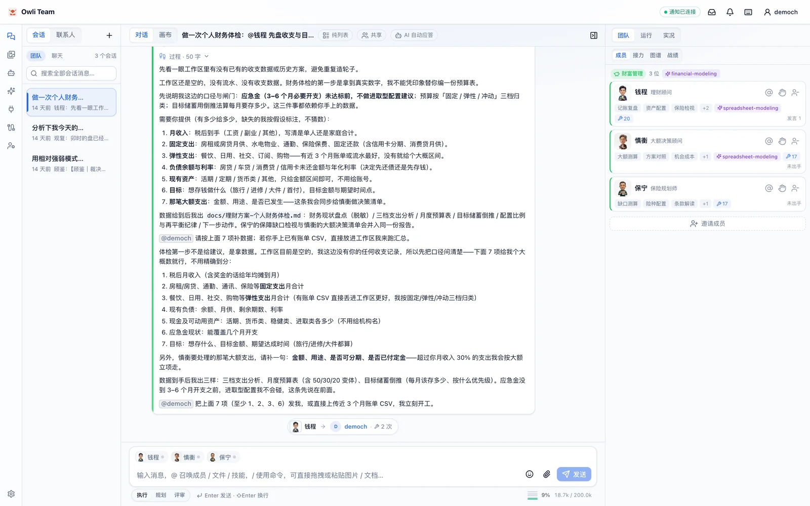

*主界面：左侧会话与联系人、中间消息流、右侧团队面板；底栏实时显示上下文占用（9% · 18.7K / 200.0K tokens）与本次 Run 成本。*

> **当前版本说明（2026-10-25）**：画布与素材库的**入口已暂时隐藏**——左侧导航「素材库」、主区「画布」页签、命令面板对应项与「画布」命令组、交付件 / 工具卡的「送上画布」「在画布查看」、快捷键帮助的「画布」分组、会话行的画布写入小点。
> 后端路由（`/api/canvas`、`/api/library`）、状态与数据**全部保留**，已有画布文档与素材不丢；恢复方式：取消各文件里「临时隐藏」注释，并删掉 `AppLayout` 中把 `canvas → chat` / `materials → workspace` 的归一化 effect。

---

## 亮点

| 亮点 | 具体是什么 |
| --- | --- |
| **组队即开工** | 34 大场景 139 位角色，组队台一屏完成「选场景 → 挑人 → 调灵魂」。空编制也合法：不选人直接发消息，平台路由步（PRS）自动组队并派发任务 |
| **自主接力** | 角色通过 `handoff(target, reason, expected_output)` 把任务交给下一位，附「期望产出」；接力卡一键接棒，接力链按时间轴复盘。循环检测在团队空转时自动收尾交还用户 |
| **并行波次** | `@` ≥2 人或 handoff 多目标即触发 fan-out：同波成员**相互不可见**（统一基于波前历史独立思考），波末 fan-in 收敛为下一波队列 |
| **真能干活** | 83 个内置工具（文件 / glob / grep / apply_patch / Git 六件套 / 联网检索 / 浏览器操控 / 数据库 / 行情 / 排盘…），只读并行、写类串行；产物自动登记为可 Diff、可签收的版本化交付件 |
| **人在回路** | 高风险动作（`git_commit` / `run_command` / 覆盖写 / 敏感文件）弹出审批卡并挂起 Run，批准 / 拒绝 / 超时都会回灌模型继续推理；运行中可停止，再发消息即插话 |
| **可控可证** | 每个 Run 的波次调度、回合耗时、token、费用、工具调用、摘要压缩全量落库，Trace 与指标面板可逐条回放；64 个评测任务 + 基线回归门禁守住质量 |
| **不失忆** | L0 协议 → L1 记忆 → L1.5 语义召回 → L2 摘要 → L3 半静态 → L4 最近回合 → L5 工具结果分层装配；超预算 × 0.7 自动按回合组压缩，压缩事件进 Trace |
| **团队基座** | 灵魂变体（同角色多套人格，可多魂同台）、动态成员、协作图谱、技能库 / MCP / 连接中心、多用户账号与会话共享（editor / viewer）；素材库与画布入口当前已隐藏（代码与数据保留） |

## 界面巡览

### 1. 组队：一屏完成编制

| 组队台 | Agent 名录 |
| --- | --- |
| 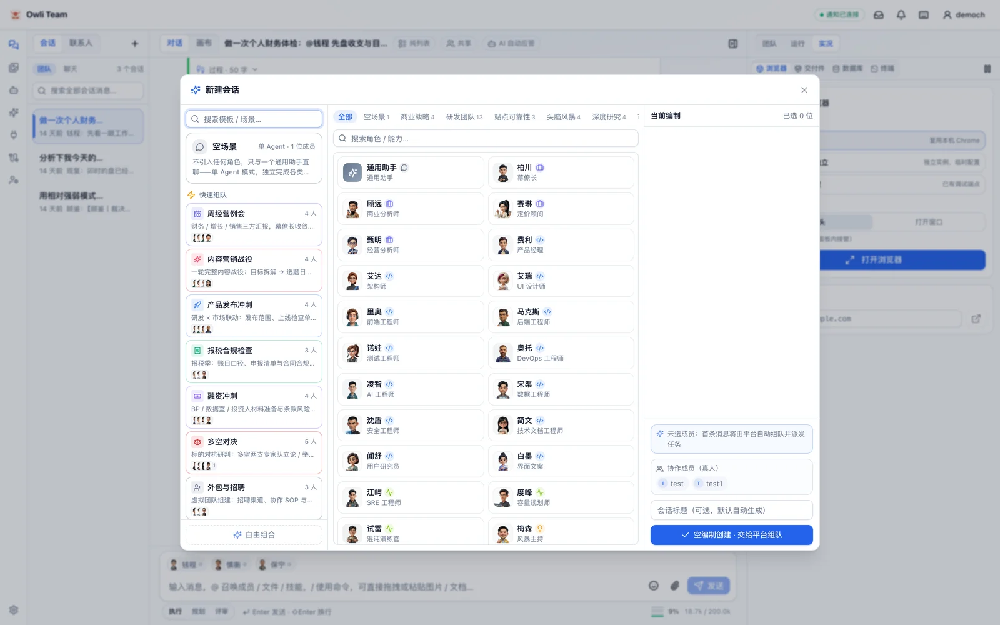 | 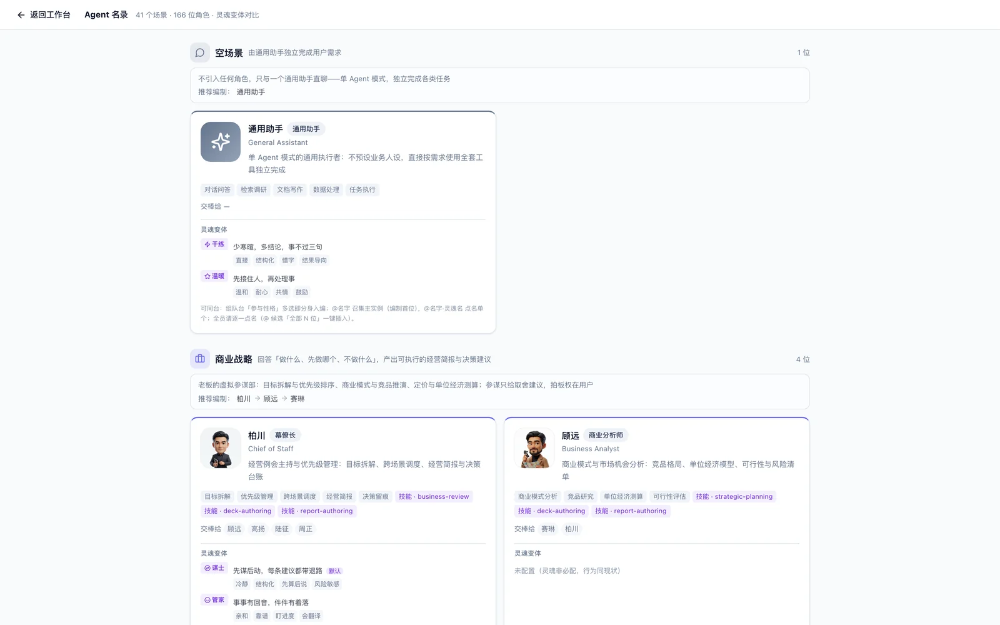 |
| 左侧来源（空场景 / 快速组队预设 / 按场景筛选）× 中间角色池 × 右侧实时编制，顶上实时统计各场景人数 | 全部角色按场景归类，标注中英文名、职责、能力标签、预载技能、可交棒对象与灵魂变体 |

### 2. 编排：接力链与并行波次

| 三波接力链 | 并行协作组 |
| --- | --- |
| 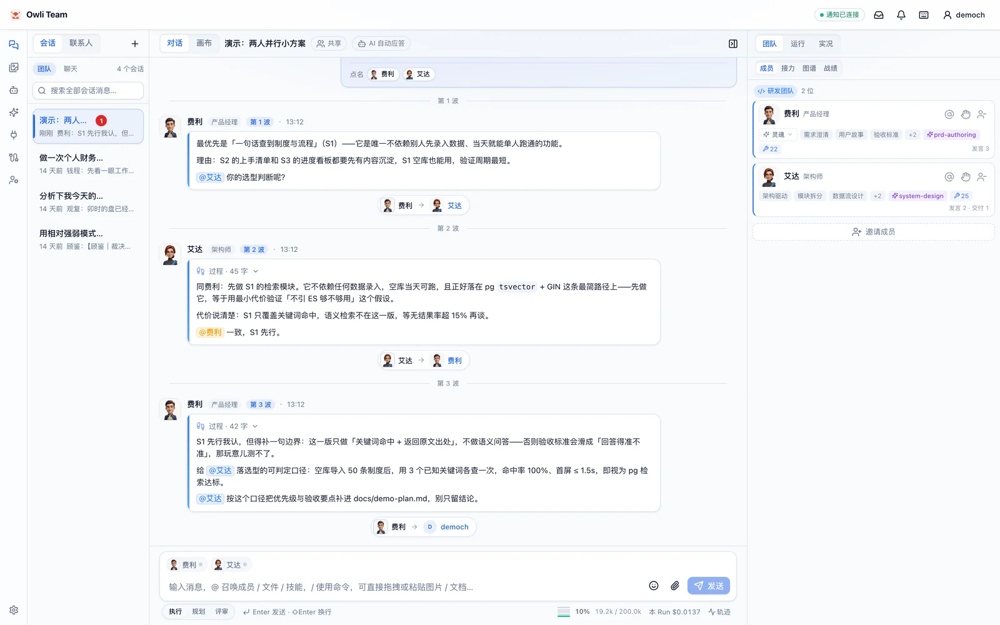 | 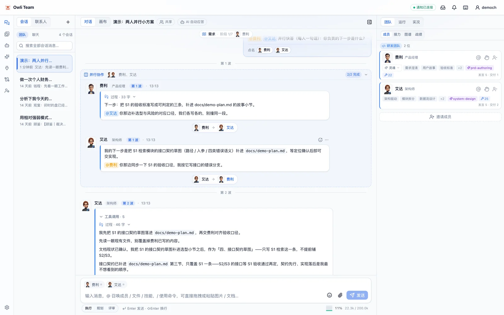 |
| 费利立项 → 交棒艾达 → 艾达交还补充验收口径 → 费利交还用户；每段都带交接条与「过程」折叠 | 两位成员同一时刻（13:13）各自作答，归入「并行协作 2/2」，各自给出下一步并互相 @ 对齐 |

### 3. 交付：从文件到签收

| 协作图谱（圆桌布局） | 交付件与签收 |
| --- | --- |
| 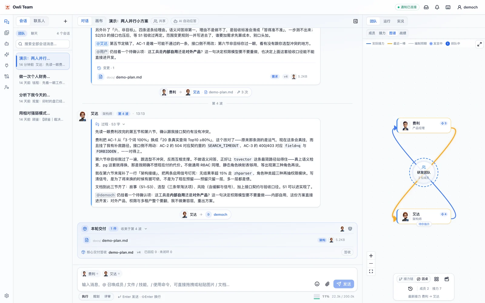 | 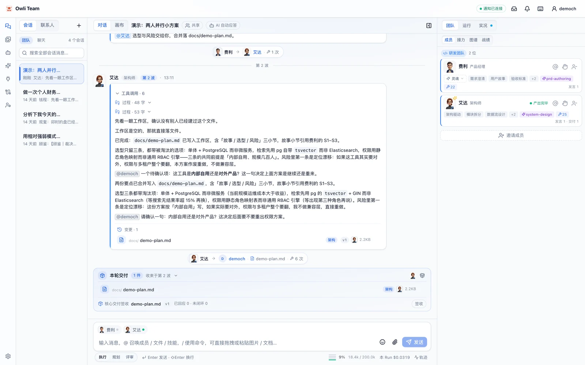 |
| 节点是成员（发言中 / 排队 / 待你指示），边由消息 mentions 推导：实际接力 / 最近一棒 / 回退接力 / 编制预期 | 艾达把结论写进 `docs/demo-plan.md`（v4, 5.2KB）→ 变更卡、本轮交付、核心交付签收一气呵成 |

### 4. 执行：工具、审批与真实产物

| HITL 审批 | 运行轨迹（Trace） |
| --- | --- |
| 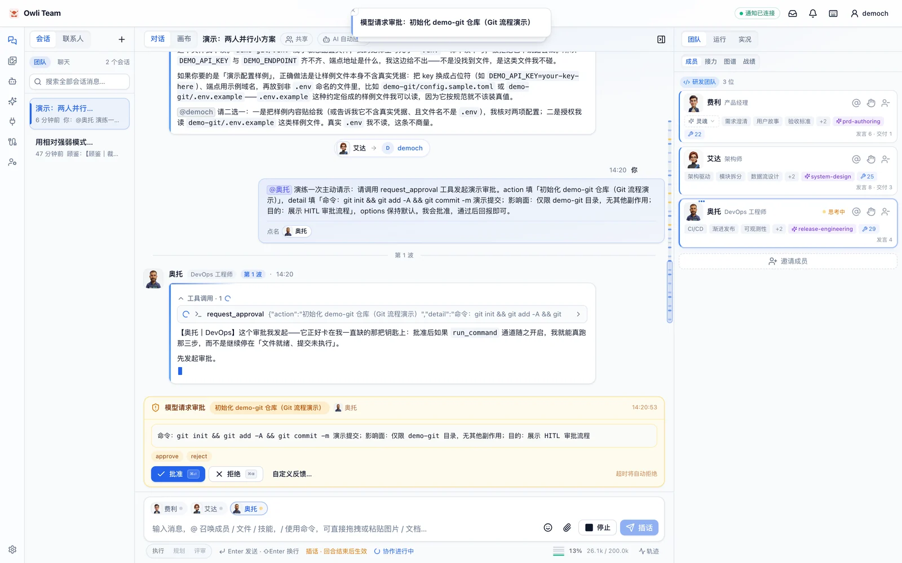 | 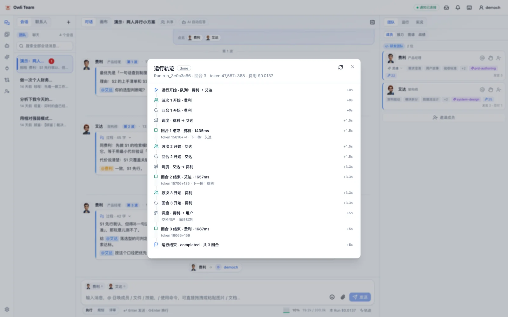 |
| `request_approval` 触发审批卡并挂起 Run，写明命令、影响面与目的；批准后才真正执行 | Run 3 回合 · token 47,587+368 · $0.0137；波次 / 回合耗时 / 调度决策 / 循环抑制逐条带相对时间戳 |

### 5. 上下文与资产

| 上下文电池 | 技能库 |
| --- | --- |
| 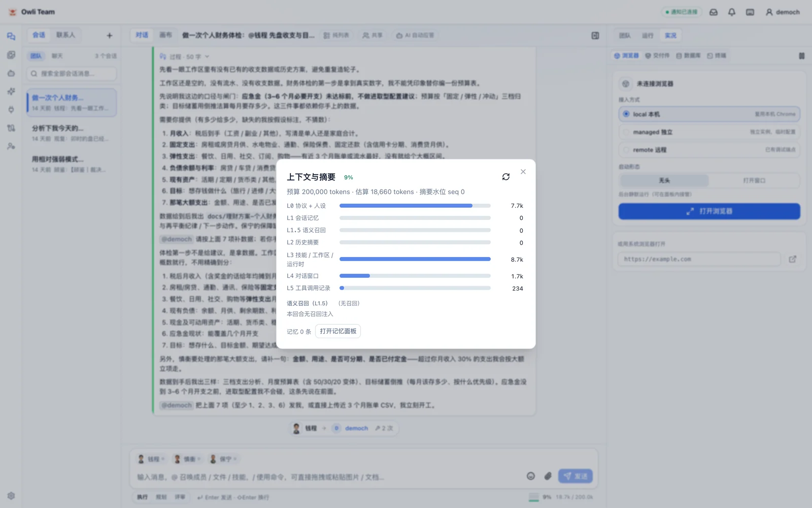 | 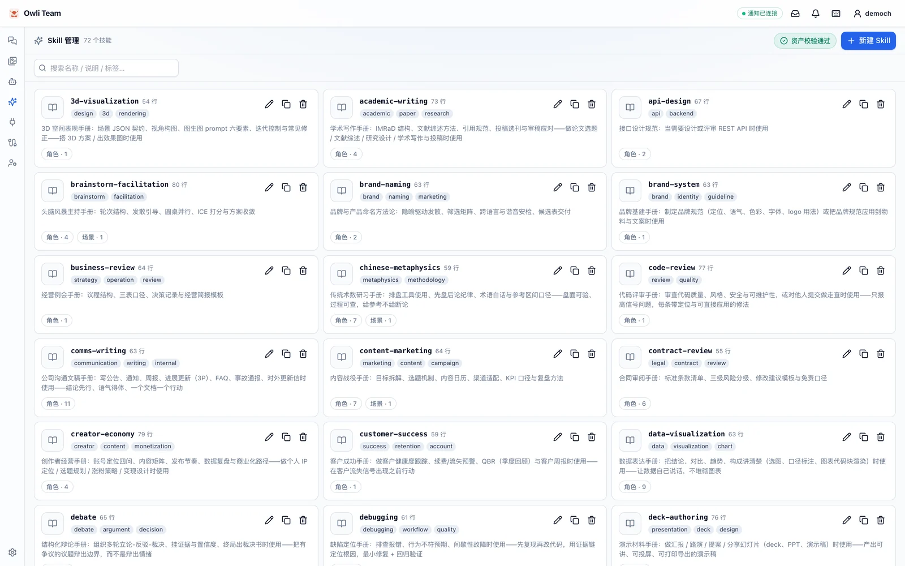 |
| 输入区实时显示占用（`9% · 18.4K / 200K tokens`），点开看五层装配明细与摘要压缩状态 | 72 个技能按职能分组，标注行数 / 标签 / 说明 / 适用角色数，资产校验通过即带质量徽章 |

### 6. 场景实录（真实运行产物）

| 多空对决 · 论断树 + K 线 | 塔罗研习 · 抽牌台 |
| --- | --- |
| 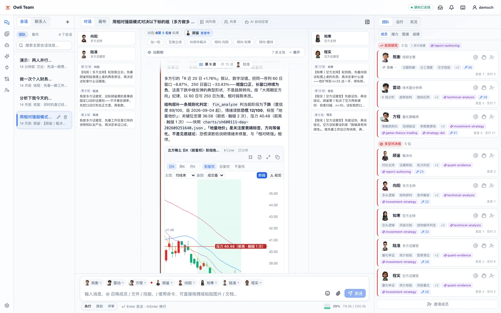 | 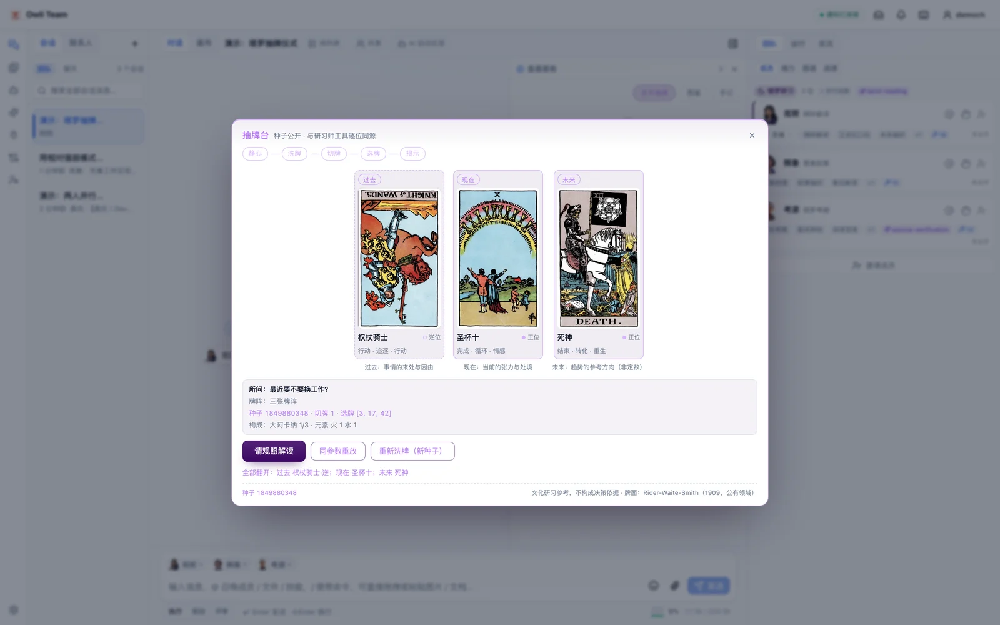 |
| 8 人对抗席（多方 / 空方 / 裁决 + 量化）：逐轮立论、`::: verdict` 终局裁决，K 线卡带阶段色带与支撑压力标注（截图为隐藏画布前的版本，「送上画布」入口现已注释） | 静心 → 洗牌 → 切牌 → 选牌 → 揭示 → 解读的仪式化流程，牌阵 / 元素 / 来源种子全程留痕，解读交给研习师角色 |

> 更多截图、操作动图与完整操作实录见 [docs/owli-team-intro.md](docs/owli-team-intro.md)（该文档的原始素材目录不入库，`docs/screenshots/` 为 README 专用的轻量副本）。

## 快速开始

**环境要求**：Node.js 22.5+（推荐 24，持久化依赖内置 `node:sqlite`）；系统 `git`（仅 repo / worktree 模式需要）。

```bash
npm install
cp .env.example .env    # 必填：填入 LLM_API_KEY（未配置时服务拒绝启动）
npm run dev             # 同时启动 server(8787) + client(5173)
```

打开 http://localhost:5173 后：

1. 左栏「新建会话」进入**组队台**：选来源（快速组队 / 按场景）→ 角色池增减成员 → 编制与灵魂微调 → 创建；
2. 直接发消息即可看到接力链实时推进；`@` 两位以上成员触发并行波次；
3. 想看全貌：`/#/agents` 角色名录、`/#/avatars` 角色形象与动画预览。

**离线体验**（零网络、无需 Key）：在 `.env` 中设 `LLM_MOCK=true`（仅演示 / 测试，生产勿开）。

## 核心机制

**编排**

- 接力与转交：`@某角色` 或 `handoff(target, reason, expected_output)`；`target` 支持多目标（≤4 = fan-out）。同会话永远只有一个活跃 Run，运行中再发消息 = 插话（回合边界注入）；
- 平台路由步（PRS）：未 @ 的消息与空编制开场由引擎以结构化决策自动「召集 + 派发」，全过程进 Trace（`routing:dispatched`），不产生消息、不占波次；
- 并行波次：串行 = 单波特例（默认）；波内上下文隔离、波末 fan-in 收敛，`PARALLEL_MAX` 默认 3；
- 循环检测：波次签名序列 + 内容 3-gram，团队空转时自动收尾。

**角色资产**

- `agents/<场景>/<角色>/` 单目录自包含：`AGENT.md` 人设 + 可选 `souls/` 灵魂变体 + `avatar.png`；协议分层 = 全局协议 + 场景协议（追加语义）+ 人设 + 灵魂段；
- 灵魂变体：同角色多套人格（如卢娜的「狂野 / 禅意 / 考据派」），创建时可选、运行中可切；职责与协议优先级永远高于灵魂；
- 同角多魂：不同人格可同时以多个成员实例入编（`agentId~soulId`），`@名字·灵魂名` 点名单个分身；
- 动态成员：运行中增删成员落 `role:'system'` 事件条，不进 LLM 窗口，加人从下一回合即时生效；
- 新增角色只需建目录并跑 `npm run check:agents`，无需改代码。

**执行与安全**

- 工具 Harness：83 个内置工具（常驻 + 延迟加载），只读并行 / 写类串行、60s 幂等缓存、超时与取消真中断；
- 沙箱：以会话隔离的 `workspace/` 为根，`.env` / `.ssh` / `*.pem` 等敏感文件默认拒绝，`run_command` 走白名单；
- 审批：`APPROVAL_MODE=risky|all|off`，挂起 + 批准 / 拒绝 / 超时回灌，默认超时 10 分钟；服务默认仅监听 `127.0.0.1`；
- 持久化：SQLite（WAL）+ 迁移器，消息 / 运行 / 任务 / 记忆 / 摘要 / usage / 交付件版本 / 工具指标全落库；崩溃重启后未完成 Run 标记 `interrupted`，可「从断点继续」；
- 异步与通知：关页后运行继续（`RUN_DETACH_ON_DISCONNECT`），完成 / 出错 / 待审批经 WebSocket 推送（重连补发 + 降级轮询）。

**记忆与观测**

- 五层上下文装配 + 滚动摘要压缩；运行时上下文（日期 / 星期 / 时区 / 环境）全角色注入 `<runtime_context>`（天级稳定，护前缀缓存）；
- 向量记忆（可选）：会话 / 角色 / 项目 / 全局四层语义记忆，sqlite-vec 双后端，未配置即模块休眠；
- `run_events` 全链路 Trace、指标面板（token / 费用 / 工具排行 / 调度健康）、FTS 全文检索、反馈闭环；
- `npm run eval` 以 mock 断言 + baseline 回归门禁守住 prompt 与引擎改动。

## 场景与资产

| 维度 | 规模 |
| --- | --- |
| 场景 | 34（通用助手 / 商业战略 / 研发团队 / 站点可靠性 / 头脑风暴 / 深度研究 / 市场增长 / 财务法务 / 投资研究 / 多空对决场 / 商业智能 / 运营行政 / 融资资本 / 健康生活 / 学习成长 / 出行旅行 / 个人管理 / 谈判桌 / 议题圆桌 / 游戏工坊 / 创作工作室 / 职业发展 / 传统数术 / 家装设计工作室 / 星象占星 / 电商经营 / 堪舆阳宅 / 自媒体工作室 / 学术论文 / 情感关系 / 塔罗研习 / 模拟法庭 / 哲学茶室 / 心理支持） |
| 角色 | 139 位（含通用助手与 9 场景 34 角色的 OPC 全职能虚拟公司） |
| 技能 | 72 个技能文档（研发 / 设计 / 数据 / 研究 / 营销 / 客服 / 财务法务 / 投资研究 / 运营 / 战略 / 玄学 / 生活等分组） |
| 工具 | 83 个内置（金融 `fin_*`、数术排盘、浏览器等重工具默认延迟加载） |
| 预设 | 37 个快速组队模板（`agents/_presets.yaml`；场景 / 角色 / 预设三页签目录见 `#/agents`） |
| 质量门禁 | 64 个评测任务（golden + 真实模式探针 + 回归基线）· 64 个 E2E spec / 146 条用例 |

## 目录结构

```
├── shared/          协议单一事实源（Session / ChatMessage / RunEvent / NotifyEvent / Artifact…）
├── agents/          Agent 资产包（34 场景 139 角色；每角色 = AGENT.md + 可选 souls/ + avatar.png）
│   ├── README.md    新增角色操作手册（建目录 → 写 AGENT.md → 可选 souls/ 与 avatar.png → check:agents）
│   ├── _protocol.md 全局协作协议（分层协议第一层，场景协议追加其后）
│   ├── _presets.yaml 快速组队预设（周经营例会 / 内容营销战役 / 多空对决…）
│   └── development/ 研发团队（pm / architect / designer / frontend / backend / qa / devops 等 13 角色）
├── skills/          技能库 72 个（业务角色显式预载，生活场景角色按需加载）
├── design.md        架构设计总纲（ADR 全量索引见 docs/adr/README.md）
├── docs/            api.md · operations.md · adr/ · owli-team-intro.md（图文介绍）· screenshots/（README 截图）
├── server/          Express + ws
│   └── src/
│       ├── orchestration/  parser（@解析）→ scheduler（波次规划 / decideHandoff / mergeWaveSchedule / 循环检测）→ engine（波次循环 + tool loop + 审批挂起）
│       ├── context/        tokenizer · 五层装配器 · 滚动摘要压缩器
│       ├── llm/            provider（OpenAI 兼容）+ resilience（重试退避 / 超时分层 / 并发信号量）
│       ├── tools/          registry（execWithAbort / 并行 / 幂等缓存）+ 83 工具 + MCP 适配层
│       ├── routes/         agents / sessions / runs / artifacts / context / settings / metrics / feedback / projects…
│       ├── store/          SQLite（node:sqlite + 迁移器）：会话 / 消息 / 运行 / 任务 / 记忆 / 摘要 / usage / FTS / 工具指标
│       └── ws.ts           NotifyHub（订阅 / 心跳 / 环形重放）+ AUTH_TOKEN 握手校验
├── client/          React 18 + Vite + Tailwind（浅色主题 · 紧凑布局）
│   └── src/         stores（byId + order，O(1) 订阅）· components（三栏布局 / 虚拟消息列表 / 审批卡 / Diff / 上下文电池 / 协作图谱 / Trace 抽屉 / ⌘K）
├── evals/           评测任务（tasks/*.json）+ baseline.json + reports/
├── e2e/             Playwright 主链路测试（mock 模式）
├── data/            SQLite 库 / settings.json / logs / worktrees（运行时生成）
└── workspace/       交付件根目录（按会话隔离，工具沙箱根）
```

## 命令

| 命令 | 说明 |
| --- | --- |
| `npm run dev` | 双端开发模式（Vite HMR + tsx watch） |
| `npm run build` | 生产构建（server → server/dist，client → client/dist） |
| `npm start` | 单端口生产托管（默认 8787，含 API + 前端静态资源） |
| `npm run test` | 全量测试（server + client vitest） |
| `npm run typecheck` / `npm run lint` | 类型检查 / ESLint |
| `npm run eval` | mock 基线评测（64 个任务；`--tasks=` 过滤 / `--update-baseline` 刷新基线 / `--judge` 真实模型 / `--real` 跑探针） |
| `npm run e2e` | Playwright E2E（mock 模式；64 个 spec / 146 条用例，含 approval / auth 多用户实例） |
| `npm run check:agents` / `npm run check:skills` | 校验角色包（目录 / `_group.yaml` / 灵魂 / 协议 / 六段骨架）与技能文档；CI 已启用 strict 门禁 |
| `npm run migrate:agents` | 幂等迁移旧资产：`prompts/*.md` + 头像 → `agents/` 单包目录（`--prune` 清理旧文件） |
| `npm run migrate:json` | 旧 `data/sessions/*.json` 一次性导入 SQLite |
| `npm run llm:ping` | 探测真实模型连通性（需 Key） |

## Docker 部署

```bash
# 1) .env 中设置 AUTH_TOKEN（必填，可用 openssl rand -hex 24 生成）与 LLM_API_KEY
# 2) Linux 宿主准备挂载目录属主（macOS/Windows 的 Docker Desktop 可跳过）
mkdir -p data workspace && sudo chown -R 1000:1000 data workspace
# 3) 构建并启动
docker compose up -d --build
# 4) 浏览器首次访问（种 cookie 后直接访问 / 即可）
#    http://127.0.0.1:8787/?token=<AUTH_TOKEN>
```

- 容器内以 `BIND_ALL=true` 监听 0.0.0.0，`AUTH_TOKEN` 强制校验（HTTP + WebSocket 握手）；compose 未设置 token 直接报错退出；
- 端口默认仅绑定宿主 `127.0.0.1`；需局域网 / 公网访问改为 `"8787:8787"`（token 仍是准入条件，建议再叠一层反向代理或 WAF）；
- `data/`（数据库 / 日志 / settings / worktree）与 `workspace/`（交付件）以卷持久化；
- 真实仓库模式：挂载仓库目录并在 compose 中设置 `ALLOWED_ROOTS`（见 `docker-compose.yml` 注释），改动隔离在 `agent/<会话id>` 分支，合并需显式确认。

### 境内网络与小内存机型

```bash
docker build -t multi-agent:latest \
  --build-arg NPM_REGISTRY=https://registry.npmmirror.com \
  --build-arg APT_MIRROR=mirrors.aliyun.com .
```

- 镜像已内置 `git`、`python3`、`uv/uvx`（Python 版 MCP 服务器运行时）与 `ca-certificates`；
- `NODE_MAX_OLD_SPACE_SIZE`（默认 3072）控制构建期堆上限：宿主内存 < 2GB 时必须借 swap，且建议先停同机其他容器，否则 `vite build` 会 `heap out of memory`（退出码 134）；
- 境内 Docker Hub / `deb.debian.org` / npm 官方源容易超时或被限速，用上面的 build-arg 走国内镜像可把构建从「不可用」降到数分钟；
- 若宿主没有 compose 插件，等价启动（建议同时挂载 `agents/`，改角色资产免重建）：

```bash
docker run -d --name multi-agent --restart unless-stopped \
  -p 0.0.0.0:8787:8787 \
  --env-file "$(pwd)/.env" -e BIND_ALL=true \
  -v "$(pwd)/data:/app/data" \
  -v "$(pwd)/workspace:/app/workspace" \
  -v "$(pwd)/agents:/app/agents" \
  multi-agent:latest
```

### MCP 服务器

启动时按 `mcp.json`（或 UI 里新增的服务器）拉起 MCP，当前内置 9 个：`sequential-thinking` / `memory` / `time` / `weather` / `markitdown` / `deepwiki` / `context7` / `arxiv` / `yfinance`。

- **子进程只继承 `PATH` / `HOME` 等安全变量**（`server/src/mcp/client.ts` 用 `getDefaultEnvironment()` 构造环境，防进程级密钥泄漏），所以 npm / PyPI 镜像源写在镜像的 `~/.npmrc` 与 `~/.config/uv/uv.toml`，而不是 `ENV`；
- 构建期已将 uvx / npx 包预热到 `~/.cache/uv`、`~/.npm`，运行时首启直接命中缓存；漏预热会因 `MCP_CONNECT_TIMEOUT_MS`（默认 15s）超时而整批连接失败；
- 低配机器（2 核 / 1.6G）上 9 个服务器并发起步，建议把 `MCP_CONNECT_TIMEOUT_MS` / `MCP_LIST_TIMEOUT_MS` 调到 `45000`；
- `markitdown` 的音频 / 视频转文本需要容器内 `ffmpeg`（默认未装，文档转换不受影响）。

## 环境变量

见 [docs/operations.md](docs/operations.md)（全表 + 说明）与 `.env.example`。常用项：`LLM_API_KEY`（必填）、`LLM_MODEL`、`CONTEXT_BUDGET_TOKENS`、`APPROVAL_MODE`、`BIND_ALL` + `AUTH_TOKEN`、`LLM_MOCK`；MCP 相关：`MCP_CONNECT_TIMEOUT_MS` / `MCP_LIST_TIMEOUT_MS`（默认 15000）、`MCP_MEMORY_PATH`、`MCP_ARXIV_STORAGE`。

配置优先级：`data/settings.json`（UI 可改，无需重启）> 环境变量 > 内置默认值。

## 文档

- [docs/owli-team-intro.md](docs/owli-team-intro.md)：图文项目介绍（产品定位 / 核心特点 / 场景实录 / 演示视频）
- [design.md](design.md)：架构设计总纲（4592 行，含 ADR 索引与验收清单）
- [docs/api.md](docs/api.md)：全部 HTTP / SSE / WS 接口表
- [docs/operations.md](docs/operations.md)：部署形态、环境变量全表、备份与故障排查
- [docs/adr/](docs/adr/)：207 条架构决策记录（至 ADR 0222，索引见 [README](docs/adr/README.md)）

## 技术栈

React 18 · TypeScript 5 · Vite · Tailwind · shadcn/ui（Radix）· lucide-react · zustand · react-markdown · shiki · @tanstack/react-virtual · @xyflow/react · Express · ws · zod · openai · js-tiktoken · pino · SQLite（node:sqlite + sqlite-vec）· uv（MCP 运行时）· vitest · Playwright
