# Owli Team 完全指南：把「团队协作」做成 AI 的基础设施

> 一份面向学习者、架构评审者与商业决策者的完整讲解。
> 从「为什么需要它」讲到「它是怎么实现的」，再到「如何扩展与上线」。

| 项目 | 说明 |
| --- | --- |
| 文档定位 | 项目讲解 + 架构设计 + 上手教程 + 扩展手册（四合一） |
| 适用读者 | 零基础学习者、全栈工程师、AI 应用架构师、技术负责人 / 产品负责人 |
| 对应代码 | 仓库当前主线（41 场景 / 139 位已成稿角色 / 76 个技能 / 83 个工具） |
| 阅读建议 | 第一次读：第 1–4 章 + 第 8–9 章；要改代码：第 5–7 章；要上线：第 16 章 |

---

## 目录

- [1. 为什么需要 Owli Team](#1-为什么需要-owli-team)
- [2. 产品全貌：一屏之内，一个团队](#2-产品全貌一屏之内一个团队)
- [3. 10 分钟跑起来](#3-10-分钟跑起来)
- [4. 总体架构：五个平面](#4-总体架构五个平面)
- [5. 核心设计一：多 Agent 编排引擎](#5-核心设计一多-agent-编排引擎)
- [6. 核心设计二：上下文工程](#6-核心设计二上下文工程)
- [7. 核心设计三：工具 Harness 与安全边界](#7-核心设计三工具-harness-与安全边界)
- [8. Agent 设计：资产即代码](#8-agent-设计资产即代码)
- [9. 多 Agent 协作范式：执行 / 规划 / 评审](#9-多-agent-协作范式执行--规划--评审)
- [10. 记忆系统：不失忆的团队](#10-记忆系统不失忆的团队)
- [11. 数据与持久化：可回放的事实](#11-数据与持久化可回放的事实)
- [12. 实时与异步：关掉页面，任务继续](#12-实时与异步关掉页面任务继续)
- [13. 前端架构：三栏工作台与流式渲染](#13-前端架构三栏工作台与流式渲染)
- [14. 可观测性与质量门禁](#14-可观测性与质量门禁)
- [15. 扩展指南：加人、加技能、加工具](#15-扩展指南加人加技能加工具)
- [16. 部署与运维](#16-部署与运维)
- [17. 设计取舍与商业价值](#17-设计取舍与商业价值)
- [18. 学习路径：从小白到改造者](#18-学习路径从小白到改造者)
- [19. 附录：术语、配置、API 速查](#19-附录术语配置api-速查)

### 阅读路线图

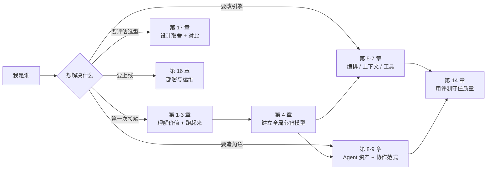

---

# 1. 为什么需要 Owli Team

## 1.1 三个真实痛点

把大模型接进业务流程，几乎所有人都会依次撞上三堵墙。

**第一堵墙：单 Agent 的能力天花板。**
一个模型再强，也很难同时是产品经理、架构师、设计师、测试和运维。你给它写一段「你既是产品经理又是架构师还是测试」的提示词，得到的往往不是全能，而是**人格分裂**：它一会儿拆需求，一会儿写代码，最后一页总结里把没做的事说成做完了。

**第二堵墙：多 Agent 的「聊天室困境」。**
把几个 Agent 拉进一个群聊，听起来很美好，实际会迅速退化成三种失败模式：

| 失败模式 | 现象 | 根因 |
| --- | --- | --- |
| 抢话 | 所有人同时发言，互相重复 | 没有发言权与队列 |
| 踢皮球 | A 交给 B，B 又交回 A，无限循环 | 没有循环检测与收尾机制 |
| 断片 | 第 5 个角色忘了第 1 个角色定的口径 | 没有上下文分层与压缩策略 |

**第三堵墙：不可控、不可证。**
真正落地时，业务方会问三个问题：**它到底做了什么？花了多少钱？出了事谁负责？** 如果答案只能靠翻聊天记录，这个系统就永远停留在演示阶段。

## 1.2 Owli Team 的答案

Owli Team 不是「给一个模型换套提示词」，而是把**团队协作本身**做成基础设施。它用工程手段正面回答了上面三堵墙：

| 痛点 | Owli Team 的机制 | 一句话解释 |
| --- | --- | --- |
| 单 Agent 天花板 | **角色资产化**：41 个场景、139 位可出场角色，每人一份独立人设 + 能力 + 工具白名单 | 专业的人做专业的事 |
| 抢话 / 踢皮球 | **接力调度器**：单活跃 Run、@ 解析、波次合并、四层循环检测 | 有队列、有裁判、有刹车 |
| 断片 | **五层上下文装配 + 滚动摘要 + 四层记忆** | 重要的东西永远不丢 |
| 不可控 | **HITL 审批 + 沙箱 + 敏感文件拒读** | 高风险动作必须人点头 |
| 不可证 | **每一波、每一 token、每次工具调用全量落库** | Trace 可逐条回放 |
| 质量漂移 | **57 个评测任务 + 基线回归门禁** | 改提示词也要过 CI |

## 1.3 一句话架构哲学

> **把「谁先说、说完交给谁、能碰什么、花多少钱、出了问题怎么查」这五件事，从提示词里拿出来，写进引擎。**

这带来一个非常关键的产品特性：**新增一个角色、一个技能、一个场景，通常不需要改一行代码**。团队的编制是资产，引擎是常量。这也是它能同时服务研发、金融、法律、健康、玄学、塔罗等 41 个场景的根本原因。

## 1.4 与常见方案的对比

| 维度 | 单 Agent + 长提示词 | Agent 框架（LangGraph 等） | 群聊式多 Agent | **Owli Team** |
| --- | --- | --- | --- | --- |
| 上手成本 | 低 | 高（要写图） | 低 | **低（装完即用）** |
| 角色专业度 | 靠一段提示词切换 | 需自行设计 | 弱 | **单包资产 + 六段骨架 + 质检门禁** |
| 接力可控性 | 无 | 需自建 | 无 | **调度器 + 循环检测 + 手动接力** |
| 并行能力 | 无 | 需自建 | 混乱 | **波次隔离 + fan-in 收敛** |
| 上下文管理 | 全塞进去 | 需自建 | 很快爆窗 | **五层装配 + 压缩 + 记忆** |
| 工具安全 | 无 | 需自建 | 无 | **审批门 + 沙箱 + 敏感文件策略** |
| 可观测性 | 日志 | 需自建 | 聊天记录 | **Trace / 指标 / 评测 / 回放** |
| 交付物 | 聊天文本 | 自行处理 | 聊天文本 | **版本化交付件 + Diff + 签收** |

一句话总结差异：**别的方案给你积木，Owli Team 给你一支已经排练过的团队，和一套能审计的排练记录。**

---

# 2. 产品全貌：一屏之内，一个团队

## 2.1 能力地图

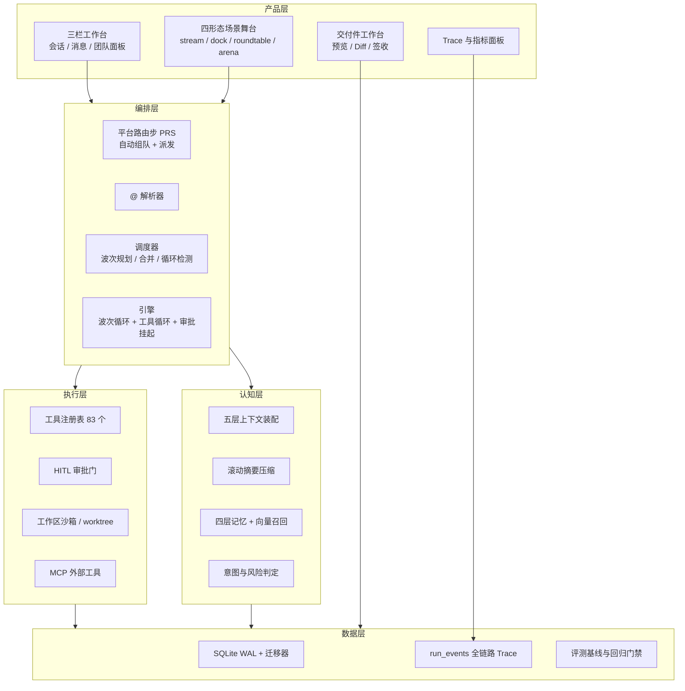

## 2.2 规模数字（以仓库当前状态为准）

| 维度 | 数量 | 说明 |
| --- | --- | --- |
| 场景 | **41** | 研发、SRE、战略、研究、投资、多空对决、塔罗、堪舆、照护…… |
| 角色目录 | **163** | 其中 **139 位**已完成 `AGENT.md` 成稿，其余为预留位 |
| 灵魂变体 | **25** | 同一角色的多套人格，可同台 |
| 技能文档 | **76** | 研发 / 设计 / 数据 / 研究 / 营销 / 法务 / 投资 / 玄学 / 生活 |
| 内置工具 | **83** | 其中 **42 个**为延迟加载（浏览器、金融、排盘、媒体等） |
| 评测任务 | **57** | Mock 断言 + 真实模式探针 + 回归基线 |
| E2E 用例 | **64 个 spec / 约 150 条** | Playwright，含审批与多用户实例 |
| 架构决策记录 | **211 条 ADR** | 每条含背景、结论、被否决方案 |

> 为什么数字这么重要？因为它证明了这套架构的**边际成本曲线**：引擎写完一次，之后每加一个专业角色只写 Markdown。这正是平台型产品与项目型交付的分水岭。

## 2.3 界面巡览：六个关键工作面

| 工作面 | 位置 | 解决什么问题 | 亮点 |
| --- | --- | --- | --- |
| **组队台** | 新建会话 | 选场景 → 挑人 → 调灵魂 | 一屏完成编制，空编制也合法 |
| **对话流** | 中央主区 | 看团队怎么接力 | 交接条、并行波次分组、过程折叠 |
| **团队面板** | 右侧 | 谁在场、谁在说话、谁在排队 | 实时状态 + 协作图谱 |
| **交付件** | 主区 Tab | 团队到底产出了什么 | 9 类预览、版本 Diff、签收 |
| **Trace** | 运行详情 | 这一跑发生了什么 | 波次 / 耗时 / token / 费用 / 调度决策 |
| **上下文电池** | 输入区上方 | 还剩多少上下文 | 五层明细 + 压缩状态 |

### 实景截图

| 主界面：三栏工作台 | 组队台：一屏完成编制 |
| --- | --- |
|  |  |
| 左会话 / 中消息 / 右团队；底栏实时显示上下文占用与本次 Run 成本 | 选来源 → 角色池 → 实时编制与灵魂微调 |

| 三波接力链 | 并行波次 |
| --- | --- |
|  |  |
| 每一棒带交接条与「过程」折叠，可按时间轴复盘 | 同波成员同时作答，归入「并行协作 N/N」 |

| HITL 审批 | 运行轨迹 Trace |
| --- | --- |
|  |  |
| 写明命令、影响面与目的；批准后才真执行 | 波次 / 回合耗时 / 调度决策 / 循环抑制逐条可查 |

## 2.4 三个典型场景

**场景 A：研发接力**
你说「帮我设计一个登录功能」。产品经理费利先拆需求，写出 `docs/需求文档-登录.md`；然后 `handoff` 给架构师艾达；艾达出技术方案，再交棒给设计师、前端、后端、QA、DevOps。每一棒都带着「期望产出」和「交接包」。

**场景 B：多空对决**
8 人对抗席：多方、空方、裁决与量化。逐轮立论，K 线卡带阶段色带与支撑压力标注，最后 `::: verdict` 输出终局裁决。这不是聊天，而是一场有规则的结构化对抗。

**场景 C：塔罗研习**
静心 → 洗牌 → 切牌 → 选牌 → 揭示 → 解读。牌阵、元素、来源种子全程留痕。看似玄学，底层仍是同一套：场景声明 → 成员编制 → 工具调用 → 结构化产物。

> **架构启示**：三个场景差异极大，但没有任何一个需要改引擎。差异全部收敛在 `agents/<场景>/` 的资产与少量声明字段里。这就是「资产即代码」的威力。

---

# 3. 10 分钟跑起来

## 3.1 环境要求

| 依赖 | 版本 | 为什么需要 |
| --- | --- | --- |
| Node.js | **22.5+（推荐 24）** | 持久化依赖内置 `node:sqlite` |
| npm | 10+ | workspace 管理 |
| Git | 系统安装 | `repo` / `worktree` 工作区模式与 Git 工具 |
| LLM API Key | 任一 OpenAI 兼容端点 | DeepSeek / OpenAI / Ollama / 自建网关均可 |

## 3.2 三步启动

```bash
npm install                  # 安装根 + client/server/shared 三个 workspace
cp .env.example .env         # 必填 LLM_API_KEY
npm run dev                  # server:8787 + client:5173
```

打开 `http://localhost:5173`，你会看到三栏工作台。

最小可用 `.env`：

```dotenv
# 必填：模型服务
LLM_API_KEY=sk-xxxxxxxx
LLM_BASE_URL=https://api.deepseek.com/v1
LLM_MODEL=deepseek-chat

# 必填（仅公网部署）：访问令牌
# AUTH_TOKEN=change-me

# 常用旋钮
CONTEXT_BUDGET_TOKENS=60000
MAX_TURNS_PER_RUN=10
PARALLEL_MAX=3
APPROVAL_MODE=risky
```

> **设计细节**：`LLM_API_KEY` 缺失时服务会**拒绝启动**（fail-fast），而不是悄悄降级成一个「假装能用」的系统。唯一例外是显式设置 `LLM_MOCK=true`（仅演示 / 测试）。这条 ADR 看似不近人情，却避免了很多线上事故：配置错误必须在一开始就暴露。

## 3.3 首次体验剧本（照着做即可）

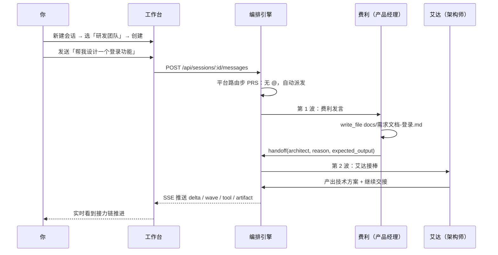

**第 1 分钟：组队。** 左栏「新建会话」进入组队台。左侧选来源（空场景 / 快速组队预设 / 按场景筛选），中间角色池，右侧实时编制。

**第 2 分钟：发消息。** 直接输入需求。注意你**不需要 @ 任何人**——平台路由步会自动判断该派给谁。

**第 3 分钟：看接力。** 消息流里会出现交接条：「费利 → 艾达，期望产出：技术方案」。点「过程」可以展开它的思考摘要。

**第 4 分钟：看并行。** 发送 `@里奥 @马克斯 分别评估前端与后端方案`，两位成员会在**同一时刻**各自作答，归入「并行协作 2/2」。

**第 5 分钟：看交付件。** 切到主区「交付件」Tab，你会看到 `docs/需求文档-登录.md`，可以预览、看版本 Diff。

**第 6 分钟：触发审批。** 让它执行一条命令，例如「用 run_command 看一下当前目录」。`APPROVAL_MODE=risky` 下会弹出审批卡，写明命令、影响面和目的。你点「批准」它才真的执行。

**第 7 分钟：看 Trace。** 打开运行详情：第几波、每回合耗时、prompt / completion token、费用、调度决策、循环抑制记录，全部带相对时间戳。

**第 8 分钟：插话。** 运行中再发一条消息，它不会新建 Run，而是在回合边界注入上下文——像在会议里补充一句。

**第 9 分钟：停止与继续。** 点停止可随时中断；「继续生成」可续写；崩溃重启后未完成的 Run 会标记 `interrupted`，支持「从断点继续」。

**第 10 分钟：换个场景。** 新建一个「多空对决」或「塔罗研习」会话，感受同一引擎如何承载完全不同的玩法。

## 3.4 零网络离线体验

```bash
# .env
LLM_MOCK=true
```

Mock 模式会按剧本确定性输出，仍会真实调用工具（写文件、请求审批）。它有两个用途：E2E 测试，以及给没有 Key 的人演示完整流程。生产环境**不要**开启。

## 3.5 常见问题

| 现象 | 原因 | 解决 |
| --- | --- | --- |
| 启动即退出 | 未配置 `LLM_API_KEY` | 填 Key，或临时 `LLM_MOCK=true` |
| 页面空白 / 401 | 公网模式未带令牌 | 访问 `/?token=<AUTH_TOKEN>` |
| 工具一直转圈后失败 | 命令不在白名单 / 超时 | 看工具卡错误摘要，调 `ALLOWED_COMMANDS` |
| 上下文很快满 | 预算太小或历史太长 | 调 `CONTEXT_BUDGET_TOKENS`，或让它写文件而非贴长文 |
| 团队来回踢皮球 | 任务定义不清 | 升级到「规划范式」先出计划，或用「手动接力」 |
| 找不到某个角色 | 该目录尚未成稿 `AGENT.md` | 跑 `npm run check:agents` 看清单 |

---

# 4. 总体架构：五个平面

## 4.1 分层架构

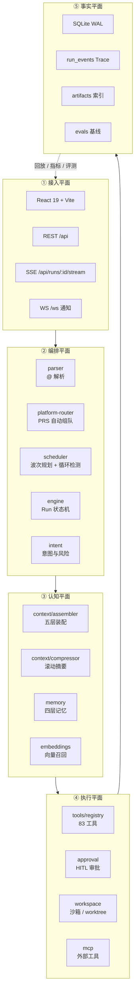

**为什么这么分层？** 因为每一层都可以独立替换：

- 换模型：只动 `llm/`，OpenAI 兼容协议是唯一边界；
- 换存储：`store/db.ts` 有 `SqlDriver` 接口，SQLite 可替换为 Postgres；
- 换前端：所有状态都从 REST + SSE 来，换 UI 不影响引擎；
- 加角色：只动 `agents/`，不动任何 TypeScript。

## 4.2 技术栈

| 层 | 选型 | 选型理由 |
| --- | --- | --- |
| 前端 | React 19 + TypeScript + Vite + Tailwind + zustand | 流式渲染需要细粒度状态；zustand 无 Provider 嵌套 |
| 图可视化 | React Flow | 协作图谱与画布共用 |
| 后端 | Node.js + Express 4 + ws | 与前端同语言，SSE / 子进程 / 文件系统都自然 |
| 模型接入 | `openai` SDK + 自定义 `baseURL` | 任何 OpenAI 兼容端点零改造接入 |
| 持久化 | `node:sqlite`（WAL）+ 顺序迁移器 | 零外部依赖、事务、FTS5、可备份 |
| 分词计量 | `js-tiktoken` + 运行期校准 | 不追求精确，追求「稳定可校准」 |
| 校验 | zod | 资产 front-matter、工具参数、API 入参统一 |
| 构建 | tsup（server）+ Vite（client） | 快、产物小 |
| 测试 | Vitest + Playwright + 自研 eval | 单测 / 端到端 / 语义回归三层 |

## 4.3 目录地图

```
owli-team/
├── shared/                 协议单一事实源（前端与服务端共享类型）
│   └── src/types.ts        Session / ChatMessage / RunEvent / Artifact / Plan ...
├── agents/                 41 场景 · 163 角色目录
│   ├── _protocol.md        全局协作协议（L0 第一层）
│   ├── _presets.yaml       快速组队预设
│   └── development/        研发团队（13 角色）
│       ├── _group.yaml     场景元数据（编制链 / 并行 / 舞台形态）
│       ├── _protocol.md    场景协议（追加在全局协议之后）
│       └── pm/AGENT.md     角色定义（front-matter + 六段人设）
├── skills/                 76 个技能文档（渐进式披露）
├── server/src/
│   ├── orchestration/      parser · scheduler · engine · platform-router · intent
│   ├── context/            assembler · compressor · tokenizer · service
│   ├── tools/              registry · builtin · discovery · 各领域工具
│   ├── store/              sessions · memory · artifacts · runs · migrations
│   ├── llm/                provider · openai · resilience · mock
│   ├── routes/             REST API（30+ 路由文件）
│   ├── auth/               多用户 · 会话共享 ACL
│   ├── mcp/                MCP 客户端与运行时
│   └── eval/               断言执行器
├── client/src/
│   ├── stores/             26 个 zustand store
│   ├── components/chat/    消息流 · 工具卡 · 审批卡 · 50+ Markdown 扩展卡
│   ├── components/scene/   四形态舞台
│   └── pages/              名录 · 头像预览 · 登录
├── evals/                  57 个评测任务 + baseline.json
├── e2e/                    64 个 Playwright spec
├── docs/adr/               211 条架构决策记录
└── design.md               4595 行设计总纲
```

## 4.4 一次 Run 的完整生命周期

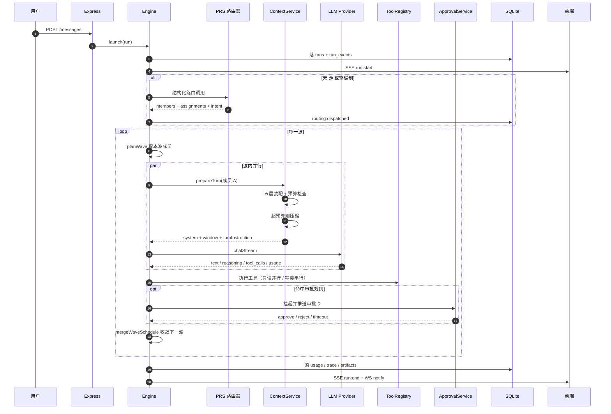

**关键设计：所有状态变更都先落库，再广播。** 这让「刷新页面」「换设备」「服务重启」都不会丢事实——前端只是事实的一个视图。

---

# 5. 核心设计一：多 Agent 编排引擎

这是整个项目的心脏。理解了这一章，你就理解了 Owli Team 与「多 Agent 套壳」的全部区别。

## 5.1 为什么是「接力」而不是「群聊」

群聊式多 Agent 的默认假设是「大家自由讨论」。但真实团队不是这样工作的：

- 会议有**议程**（谁先讲）；
- 工作有**交接**（我做完给你）；
- 讨论有**收敛**（主持人收尾）。

Owli Team 把这三个隐喻变成了三个机制：

| 隐喻 | 机制 | 实现 |
| --- | --- | --- |
| 议程 | 波次队列 | `record.queue` + `planWave()` |
| 交接 | handoff | 工具调用 + `mergeWaveSchedule()` |
| 收敛 | 交还用户 | 行首 `@用户` / `handoff(user)` |

> **小白类比**：把它想成一条**接力赛道**。同一时刻只有一个人在跑（或者被明确安排的一组人同时跑），棒子交给谁由调度器裁决，跑完要交还给教练（用户）。

## 5.2 三种触发方式

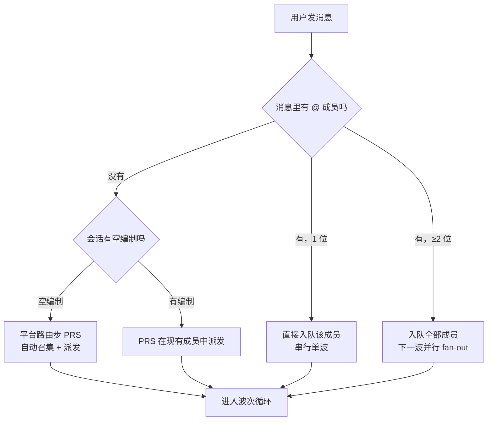

**方式一：`@` 点名。** 用户显式指定谁先发言。解析器支持中文名、id、`名字·灵魂名`（分身）、人类成员名。

**方式二：`handoff` 工具。** 角色在回合结束时调用，声明把棒子交给谁、为什么、期望产出是什么。这是**唯一权威的转交通道**——正文里的 `@某人` 只是给观众看的标注。

**方式三：平台路由步（PRS）。** 未 @ 的消息由引擎做一次结构化 LLM 调用，输出「召集谁 + 派给谁 + 用什么范式 + 风险等级」。它**不产生消息、不占波次**，只留下一条 `routing:dispatched` 审计轨迹。

> **为什么 PRS 很重要？** 它把「组队」从用户的认知负担变成了平台的默认能力。用户不需要知道团队里有谁，只需要说需求。

## 5.3 @ 解析器：细节决定成败

解析 @ 看起来简单，实际处处是坑：`@用户名` 不能误判成 `@用户`；`@费利克斯` 不能误判成 `@费利`；纪要容器里的待办 `@负责人` 不能触发转交。

```ts
// server/src/orchestration/parser.ts
/** 名字后不能紧跟字母 / 数字 / 下划线（避免 `@用户名`、`@pm2` 之类误匹配） */
const BOUNDARY = '(?![\\p{L}\\p{N}_])'
/** 分身 token 额外排除 `·`：拼错时不得回退到裸名（防一个错字召唤全部实例） */
const MEMBER_BOUNDARY = '(?![\\p{L}\\p{N}_·])'

export function parseMentionsWithTokens(raw: string, tokens: MentionToken[]): ParseResult {
  const mentions: string[] = []
  // 纪要容器内的 @ 是派活锚点，不参与转交解析
  const text = stripMinutesBlocks(raw)

  // 长 token 优先，保证「名字·灵魂名」不被裸名抢先命中
  const ordered = [...tokens].sort((a, b) => b.token.length - a.token.length)
  const lookup = new Map(ordered.map((t) => [t.token.toLowerCase(), t.members]))
  const alternation = ordered.map((t) => escapeRegExp(t.token)).join('|')
  const re = new RegExp(`@(${alternation})${MEMBER_BOUNDARY}`, 'giu')

  for (const match of text.matchAll(re)) {
    const members = lookup.get(match[1].toLowerCase())
    if (!members) continue
    for (const key of members) {
      if (!mentions.includes(key)) mentions.push(key)
    }
  }

  // 只有「行首 @用户」才算交还（句中提及不结束运行）
  const userRe = new RegExp(`(?:^|\\n)[\\s>*_-]*@(${USER_ALIASES.map(escapeRegExp).join('|')})${BOUNDARY}`, 'iu')
  return { text: raw, mentions, handedToUser: userRe.test(text) }
}
```

**三个值得学习的工程决策：**

1. **长 token 优先排序**：正则 alternation 是「先匹配先赢」，必须让更长的 token 排在前面。
2. **边界断言而非 `\b`**：`\b` 对中文无效，必须用 Unicode 属性类。
3. **容器剥离**：`stripMinutesBlocks` 用栈式匹配处理 `::: minutes`，未闭合时 fail-safe 保留原文。

## 5.4 调度器：两个纯函数 + 一个波规划器

调度器被刻意设计成**纯函数**，不碰数据库、不调模型。这带来两个好处：可单测、可回放。

### 5.4.1 波规划 `planWave`

```ts
// 触发规则取并集；均不满足 = 串行单成员
export function planWave(input: PlanWaveInput): PlannedWave {
  const { queue, groupOf, globalParallelMax } = input
  if (queue.length === 0) return { members: [], parallel: false }

  const capOf = (sceneMax?: number): number => {
    if (globalParallelMax <= 1) return 1        // PARALLEL_MAX=1 关闭并行
    return Math.max(1, sceneMax ?? globalParallelMax)
  }

  // 规则 1：显式触发（用户 @≥2 / handoff 多目标）—— 可跨场景混搭
  if (input.forceParallel) {
    const members = queue.slice(0, capOf(groupOf(queue[0])?.parallelMax))
    return { members, parallel: members.length > 1 }
  }

  // 规则 2：场景声明 parallel: true —— 取队首连续同场景成员成波
  const group = groupOf(queue[0])
  if (group?.parallel) {
    // ... 同场景连续成员切片
  }

  // 规则 3：默认串行
  return { members: [queue[0]], parallel: false }
}
```

### 5.4.2 单成员裁决 `decideHandoff`

一个成员的转交提议要过四道闸：

| 闸门 | 规则 | 目的 |
| --- | --- | --- |
| 参与者过滤 | 只能交给在场成员（或可自动召集的资产） | 防止「幽灵成员」 |
| 自续抑制 | 不能 @ 自己 | 防止原地打转 |
| 重复剔除 | 同一目标只入队一次 | 防止队列膨胀 |
| 交还语义 | `user` 只能单独出现 | 防止「一边派活一边收尾」语义冲突 |

### 5.4.3 波次合并 `mergeWaveSchedule`

这是最能体现工程功力的地方。并行波里可能有 3 个人同时说话，每个人的转交提议需要**合并成一个下一波队列**。

```ts
// 节选：省略了 acceptedByAgent / dropped 的组装细节
export function mergeWaveSchedule(input: MergeWaveInput): MergeWaveResult {
  const { decisions, participants, signatures, waveTexts, spoken, rounds } = input

  // ① 先收集所有 accepted，再判交还 —— 顺序不能反
  const acceptedAll: string[] = []
  for (const d of decisions) {
    for (const id of d.accepted) if (!acceptedAll.includes(id)) acceptedAll.push(id)
  }

  // ② 全员交还「且无人接手」才真正收尾
  const allHanded =
    decisions.length > 0 && decisions.every((d) => d.handedToUser) && acceptedAll.length === 0
  if (allHanded) {
    return { acceptedByAgent: handedByAgent, queue: [], handedToUser: true, /* ... */ }
  }

  // ③ 循环检测：四层互补，任何一层命中都收尾
  let handedToUser = false
  let loopSuppressed = false
  let stallSuppressed = false
  if (acceptedAll.length > 0) {
    const loopHistory = [...signatures, ...acceptedAll]
    if (detectLoop(loopHistory, 6, rounds ? 6 : 4)) {
      loopSuppressed = true
      handedToUser = true
    } else if (!rounds && detectRotation(loopHistory, input.waveWriteCounts)) {
      loopSuppressed = true
      handedToUser = true
    }
  }
  if (!handedToUser && detectContentLoop(waveTexts)) {
    loopSuppressed = true
    handedToUser = true
  }
  if (!handedToUser && input.waveWriteCounts &&
      detectStall(waveTexts, input.waveWriteCounts, signatures)) {
    stallSuppressed = true
    handedToUser = true
  }

  // ④ 收尾兜底：全员沉默时，每 Run 一次按编制顺序找一位未发言者
  // ⑤ 任一人给了多目标 → 下一波并行
  const forceNextParallel = decisions.some((d) => d.accepted.length >= 2)
  return { acceptedByAgent, queue, handedToUser, loopSuppressed, stallSuppressed, forceNextParallel, /* ... */ }
}
```

**这段代码里藏着三个血泪教训（都写进了注释）：**

1. **先收集再判交还**。曾经有一条消息「先派发成员、再 @用户 报备」，旧逻辑把 `@用户` 当成全员交还，导致派发被静默丢弃。
2. **部分交还 ≠ 交还**。只要有一人接手，Run 就继续。
3. **`turn:end.mentions` 必须是「实际入队结果」，不能是「模型原始输出」**。否则 UI 会显示一个并不存在的转交事件——这是最伤信任的 bug 类型。

## 5.5 并行波次：隔离与收敛

并行不是「同时调用两次模型」这么简单，难点在**上下文一致性**。

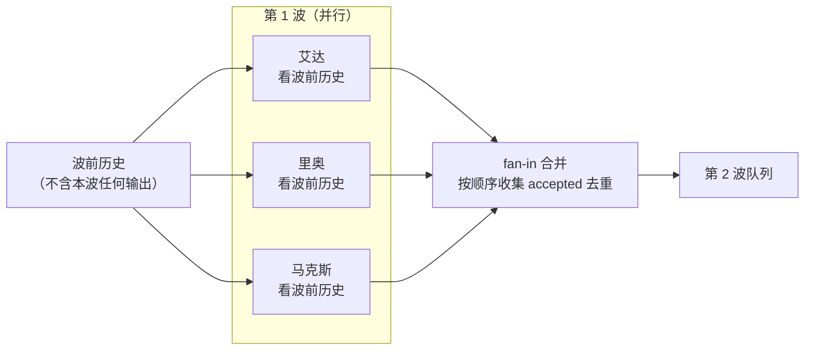

**三条铁律：**

| 铁律 | 实现 | 为什么 |
| --- | --- | --- |
| 波内互不可见 | `excludeMessageIds: handles.map(h => h.message.id)` | 否则后发言者会「看到」先发言者的输出，退化成伪并行 |
| 全波先建消息 | 先把 streaming 空消息全部落库，再并发执行 | 保证 `seq` 连续，前端排序稳定 |
| 波末统一收敛 | `Promise.all` 后走 `mergeWaveSchedule` | 三人各说各的，必须有人合并 |

**失败语义**：任一成员 `stopped` → 整波中止；任一 `timeout` / `error` → 终止 Run。但已正常产出的成员会按完成收尾，不浪费已花的 token。

## 5.6 循环检测：四层刹车

这是多 Agent 系统最容易翻车的地方。Owli Team 用了四种互补的检测，从「结构」到「语义」逐层收紧。

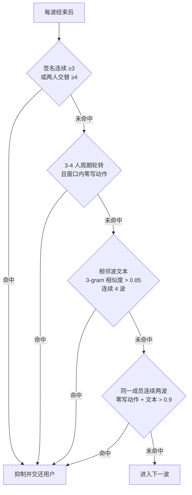

| 层 | 检测对象 | 阈值 | 适用场景 |
| --- | --- | --- | --- |
| L1 结构循环 | 波次签名序列 | 同一签名 ≥3 / 两人交替 ≥4（rounds 场景放宽到 6） | A→B→A→B 踢皮球 |
| L2 多人轮转 | 3–4 人完整周期 | 连续两轮 + 零写动作 | 三人互相「您先请」 |
| L3 内容循环 | 字符 3-gram Dice 系数 | > 0.85 连续 4 波 | 换着说法重复同一段 |
| L4 实质停滞 | 同签名 + 零写动作 + 文本相似 | > 0.9 连续 2 波 | 「讨论了但没产出」 |

**为什么不用更简单的「最多 N 轮」？** 因为合法协作也可能需要很多轮。硬上限会误杀正常的长任务，而这四层检测只杀「空转」。这是**精确性优先于简单性**的典型取舍。

内容相似度用的是字符 3-gram + Dice 系数：

```ts
export function trigramDice(a: string, b: string): number {
  const norm = (s: string) => s.replace(/\s+/g, ' ').trim().slice(0, 2000)
  // 中文按字符切分，不需要分词器；先归一化再切 gram
  const grams = (s: string) => {
    const map = new Map<string, number>()
    for (let i = 0; i + 3 <= s.length; i++) {
      const g = s.slice(i, i + 3)
      map.set(g, (map.get(g) ?? 0) + 1)
    }
    return map
  }
  // ... 计算 2 * 交集 / (|A| + |B|)
}
```

> **小白提示**：3-gram 就是「每 3 个连续字符切一刀」。两段话切出来的片段重合度越高，说明越像。这个方法对中文特别友好，因为不需要分词。

## 5.7 handoff：一个工具，五种信息

```ts
// server/src/tools/builtin.ts
const handoffTool = {
  name: 'handoff',
  description:
    '结构化转交：把接力棒交给某位（或多位）成员（或 "user" 交还用户）。' +
    '多目标 = 并行 fan-out。转交时用 artifacts 列出接手方要用的交付物路径，' +
    '省略时自动带出本轮已产出；notes 写清口径 / 验收 / 已知坑。',
  parameters: {
    type: 'object',
    properties: {
      target: {
        oneOf: [
          { type: 'string', description: '接手方 id / 姓名；或 "user"' },
          { type: 'array', items: { type: 'string' }, minItems: 2, maxItems: 4 },
        ],
      },
      reason: { type: 'string', description: '为什么转交给 TA（一句话）' },
      expected_output: { type: 'string', description: '期望接手方产出什么' },
      artifacts: {
        type: 'array', items: { type: 'string' }, maxItems: 8,
        description: '交接包：接手方需要查看的交付物路径',
      },
      notes: { type: 'string', description: '交接口径：约束 / 验收 / 已知坑（≤300 字）' },
    },
    required: ['target', 'reason'],
  },
  // ...
}
```

**为什么交接包很重要？**
因为接手方最怕两件事：**不知道看哪个文件**，和**不知道上一棒的口径**。`artifacts` 解决了前者（接手方直接 `read_file`，不用 `list_dir` 全盘盘点），`notes` 解决了后者。这两个字段把「交接损耗」从玄学变成了可设计的接口。

**路径校验的细节**：声明的 `artifacts` 会经交付件索引校验，不存在的路径**不会让转交失败**，而是被丢弃并在 `detail` 里回灌提示。这是「主链路优先」的设计哲学——交接本身比交接包完整更重要。

## 5.8 引擎主循环：一个 while，管住所有事

引擎的 `runLoop` 是整个系统最长的函数（单文件 4318 行），但骨架非常清晰：

```ts
private async runLoop(record: RunRecord): Promise<void> {
  // ① PRS：未 @ 消息 / 空编制开场，先完成「召集 + 派发」
  if (record.routingPending) {
    record.routingPending = false
    await this.routeByPlatform(record)
  }

  while (record.queue.length > 0 || record.pendingUserMessages.length > 0) {
    if (record.controller.signal.aborted) { reason = 'stopped'; break }

    // ② 波次边界消费插话（不占波次计数）
    if (record.pendingUserMessages.length > 0) { /* 注入并补接手人 */ }

    // ③ 队列只保留在场成员（动态成员变更防御）
    record.queue = record.queue.filter((id) => session.participantIds.includes(id))

    // ④ 配额闸门（日 token / 月成本）
    const quotaBlock = session.ownerId ? this.deps.quotas?.blockedReason(session.ownerId) : undefined
    if (quotaBlock) { this.notifyQuotaStop(record, quotaBlock); reason = 'quota'; break }

    // ⑤ 回合上限
    if (waveIndex >= cfg.maxTurnsPerRun) { reason = 'turn-limit'; break }

    // ⑥ 波规划
    const wave = planWave({ queue: record.queue, groupOf: ..., globalParallelMax: ..., forceParallel: ... })

    // ⑦ 全波先建消息（保证 seq 连续），再并发执行
    const handles = wave.members.map((agentId, i) => this.startWaveTurn(...))
    const outcomes = await Promise.all(
      handles.map((handle, i) => this.executeTurn(record, handle.agentId, handle.message, waveIndex, {
        excludeMessageIds: handles.map((h) => h.message.id),   // 波内隔离
        parallelPeers: wave.parallel ? [...wave.members] : [],
        mode: modes[i] ?? 'execute',
      })),
    )

    // ⑧ 失败语义 → 合并波次 → 下一波
    // ...
  }
}
```

**你会注意到的设计：**

- **只有一个活跃 Run / 会话**。运行中再发消息 = 插话，不是新建 Run。这避免了并发写同一会话的噩梦。
- **插话在波次边界消费**，不打断正在生成的回合。这是「礼貌的中断」。
- **配额与回合上限是硬闸门**，在波次开始前检查，不会跑到一半才断。

## 5.9 Run 状态机

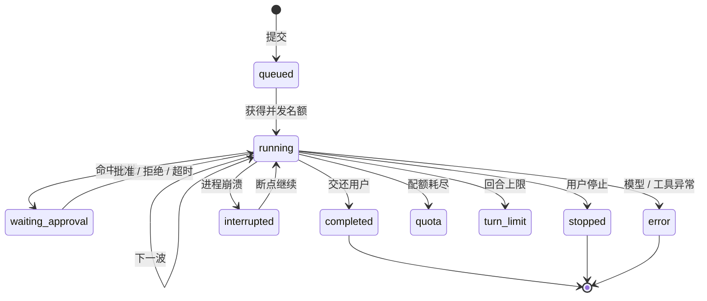

**每一种结束原因都有独立的 `reason` 落库**，前端据此显示不同收尾动画。这不是为了好看，而是为了让「为什么停了」永远可回答。

## 5.10 一条真实接力链的时序

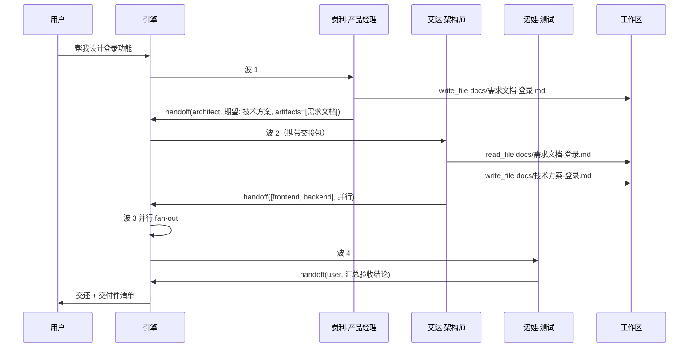

**注意波 3**：架构师一次交给两个人，引擎自动触发并行波。这就是 `handoff` 多目标 = fan-out 的语义。

---

# 6. 核心设计二：上下文工程

## 6.1 为什么上下文是「工程」而不是「拼字符串」

多 Agent 对话会同时遇到四个约束：

1. **预算有限**：模型窗口 128K / 200K，但每一波都要重发一遍历史；
2. **成本敏感**：prompt token 占大头，历史越长越贵；
3. **缓存友好**：主流模型对「前缀稳定」的 prompt 有缓存折扣，前缀一变就全价；
4. **信息不能丢**：关键约束被截断，后面全盘崩。

这四者互相冲突。Owli Team 的解法是**分层**：越稳定的越靠前，越易变的越靠后；越重要的永不裁剪，越廉价的优先裁剪。

## 6.2 五层装配

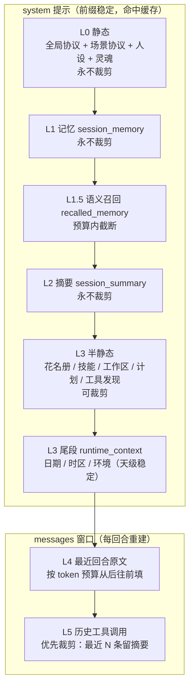

| 层 | 内容 | 裁剪策略 | 稳定性 |
| --- | --- | --- | --- |
| **L0** | 全局协议、场景协议、角色人设、灵魂段 | 永不裁剪 | **字节级稳定** |
| **L1** | 会话记忆（决策 / 约束 / 交付件 / 术语…） | 超限按 kind 优先级丢（先丢术语） | 低频变化 |
| **L1.5** | 向量语义召回 | 预算内截断 | 每回合可能变 |
| **L2** | 滚动摘要 | 永不裁剪，滚动合并 | 低频变化 |
| **L3** | 花名册、技能、工作区索引、执行中计划、工具发现、运行时上下文 | >20 文件折叠为目录统计 | **天级稳定** |
| **L4** | 最近若干回合原文 | 按预算从后往前填「回合组」 | 每回合变 |
| **L5** | 历史工具调用 | 优先裁剪 | 每回合变 |

## 6.3 前缀缓存：一个被低估的性能设计

看这一段注释，它解释了为什么 `runtime_context` 只放日期而不放时刻：

```ts
// server/src/context/assembler.ts
/**
 * 运行时上下文块（L3 尾段）：当前日期 / 时区 / 运行环境。
 * 天级稳定：同一天内任意时刻装配结果字节级一致（不破坏 system 前缀缓存）；
 * 精确时刻由回合指令注入，跨天时仅尾段变化。
 */
export function buildRuntimeContext(now: Date = new Date()): string {
  const weekday = WEEKDAYS[now.getDay()]
  const date = `${now.getFullYear()}-${pad2(now.getMonth() + 1)}-${pad2(now.getDate())}`
  return [
    '<runtime_context>',
    `- 当前日期：${date}（${weekday}）；时区：${timezoneLabel(now)}`,
    `- 运行环境：${platformLabel()}`,
    '- 涉及「今天 / 明天 / 本周 / 今年」等相对日期时一律以此为准；精确时刻见回合指令；',
    '</runtime_context>',
  ].join('\n')
}
```

**如果在这里写 `12:34` 会怎样？** 每分钟 system 前缀都变，缓存全失效。于是精确时刻被移到 `buildTurnInstruction`——那本来就是每回合新建的字符串。

> **这是「成本意识写进代码」的典型例子**：一个字段的位置，决定了整条链路是省 90% 还是多花 90%。

## 6.4 装配全景代码

```ts
// 节选：省略了花名册 / 交接对象 / 技能正文的具体渲染
export function buildSystemPrompt(input: SystemPromptInput): SystemPromptOutput {
  const { groupProtocol, sceneProtocol, agent, agentBody, preloadedSkills, skillsIndex, workspaceListing, soul } = input
  const soulSection = soul ? buildSoulSection(soul) : ''
  const rosterLine = input.roster.map((m) => `${m.label}（${m.key}｜${m.role}）`).join('、')
  const handoffLine = agent.handoff.map((id) => memberOfAgent(id)).filter(Boolean).map((m) => m!.label).join('、')

  // L0：全局协议 +（场景协议）+ 人设 +（灵魂段）
  const l0 = [groupProtocol, sceneProtocol, agentBody, soulSection]
    .filter(Boolean).join('\n\n---\n\n')

  // L1：会话记忆（无记忆时为空串）
  const l1 = input.memoryBlock?.trim() ? input.memoryBlock : ''

  // L1.5：语义召回（预算截断已在召回层完成）
  const l1_5 = input.recalledBlock?.trim() ? input.recalledBlock : ''

  // L2：历史摘要（未压缩时为空串）
  const l2 = input.summaryBlock?.trim() ? input.summaryBlock : ''

  // L3：花名册 / 技能 / 工作区 / 计划 / 工具发现 / 运行时上下文
  const l3Sections: string[] = [`# 团队花名册\n\n本会话成员：${rosterLine}\n\n你的常用交接对象：${handoffLine}`]
  if (preloadedSkills.length > 0) l3Sections.push(/* 预载技能正文 */)
  if (skillsIndex) l3Sections.push(/* 可加载技能索引 */)
  if (workspaceListing) l3Sections.push(`# 当前工作区（索引摘要）\n\n${workspaceListing}`)
  if (activePlansBlock) l3Sections.push(activePlansBlock)
  if (toolDiscoveryBlock) l3Sections.push(toolDiscoveryBlock)
  l3Sections.push(buildRuntimeContext(input.now))   // 天级稳定

  const l3 = l3Sections.join('\n\n---\n\n')
  const sections = [l0, l1, l1_5, l2, l3].filter((s) => s.trim() !== '')

  // 每层 token 数一并返回，供前端「上下文电池」展示
  return { text: sections.join('\n\n---\n\n'), layers: { l0: ..., l1: ..., l1_5: ..., l2: ..., l3: ... } }
}
```

**注意 `layers` 返回值。** 装配器不只是拼字符串，它还**报告每一层花了多少 token**。这让前端可以画出「上下文电池」的五层明细，用户能一眼看出是记忆太胖还是历史太长。

## 6.5 token 计量：从「估算」到「可校准」

```ts
// server/src/context/tokenizer.ts
/** 安全余量：估算值再 ×1.15，吸收分词差异 */
export const SAFETY_MARGIN = 1.15

let calibration = 1
const calibrationSamples: number[] = []
const CALIBRATION_WINDOW = 20

/** 无分词器时的启发式：CJK 约 1 token/字，其余约 4 字符/token */
function heuristicCount(text: string): number {
  let cjk = 0, other = 0
  for (const ch of text) {
    const code = ch.codePointAt(0) ?? 0
    if (code >= 0x3000 && code <= 0x9fff) cjk++
    else other++
  }
  return Math.ceil(cjk + other / 4)
}
```

**设计要点：**

| 机制 | 作用 |
| --- | --- |
| `cl100k_base` 统一编码 | 不追求与目标模型完全一致，追求跨模型可比 |
| ×1.15 安全余量 | 宁可保守，也不要在压缩边缘反复抖动 |
| 运行期校准 | 用每次真实调用的 `usage.prompt_tokens` 反推系数，滚动 20 次取平均 |
| 启发式兜底 | 分词器加载失败也不中断服务（CJK 1 token/字 + 其余 4 字符/token） |

## 6.6 压缩：预算 × 0.7 触发

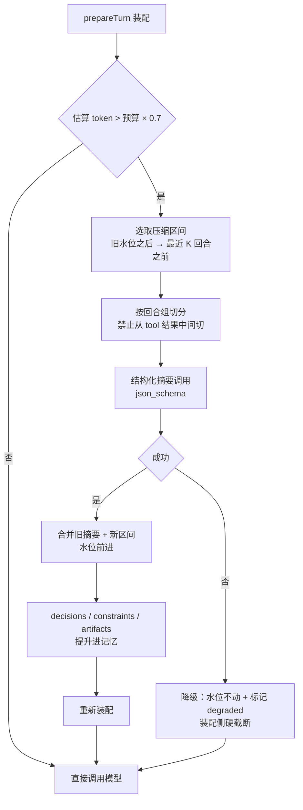

**为什么是 0.7 而不是 1.0？**
给「压缩后还要继续对话」留余量。如果等 100% 才压，压缩完立刻又满，会陷入频繁压缩的死循环。

**为什么按「回合组」切？**
因为一条 `tool` 消息必须跟着它的 `assistant` 调用消息。从中间切开会让模型看到「结果」却看不到「调用」，直接引发幻觉。这是上下文工程里最容易被忽略、后果最严重的一类 bug。

**摘要输出是结构化的：**

```ts
export const SUMMARY_SCHEMA = {
  type: 'object',
  properties: {
    completed:     { type: 'array', items: { type: 'string' } },  // 已完成（含结论）
    decisions:     { type: 'array', items: { type: 'string' } },  // 已确认决策
    constraints:   { type: 'array', items: { type: 'string' } },  // 约束 / 口径 / 边界
    artifacts:     { type: 'array', items: { type: 'string' } },  // 交付件路径（逐字保留）
    openQuestions: { type: 'array', items: { type: 'string' } },  // 未决问题
    nextSteps:     { type: 'array', items: { type: 'string' } },  // 下一步
  },
  required: ['completed', 'decisions', 'constraints', 'artifacts', 'openQuestions', 'nextSteps'],
  additionalProperties: false,
}
```

**结构化摘要的额外好处**：`decisions` / `constraints` / `artifacts` 会自动合并进 L1 记忆，按内容哈希去重。也就是说，**一次压缩顺带完成了一次知识沉淀**。

## 6.7 回合指令：唯一注入协作策略的关节

系统提示负责「你是谁、你知道什么」，回合指令负责「这一轮你要做什么」。后者是**唯一**能注入接力策略的地方：

```ts
export function buildTurnInstruction(agent, roster, queue, parallelPeers, mode, extra): string {
  const lines: string[] = []

  if (mode === 'plan') {
    lines.push(
      `现在轮到你（${agent.name}）以规划范式发言（本轮只读：不写文件、不执行改动）。`,
      '- 你的任务：产出可执行的协作计划，并调用 write_plan 提交（提交后本回合挂起）；',
      '- 步骤要求：每步包含内容与负责人（必须是本会话在场成员）；',
    )
  } else if (mode === 'review') {
    lines.push(
      `现在轮到你（${agent.name}）以评审范式发言（只读评审）。`,
      '- 请调用 submit_review 给出结构化判定（pass / conditional / fail）与发现、证据；',
    )
  } else {
    const manualRelay = extra.relayMode === 'manual'
    lines.push(
      `现在轮到你（${agent.name}）发言。`,
      ...(manualRelay
        ? ['- 若需要队友接手，调用 handoff 记录建议（手动接力：不自动接棒）；']
        : ['- 若需要队友继续推进，请调用 handoff 工具转交；']),
      `- 可交接成员：${others.join('、')}；`,
      `- 已排队的后续发言：${queueLine}。`,
    )
  }

  // 并行波：告诉成员「你们同时工作、互相看不到本轮输出」
  if (parallelPeers.length > 0) {
    lines.splice(1, 0, `- 本波并行成员：${peers}（各自独立输出，完成后统一汇总）。`)
  }
  // 交接包：上一棒的期望产出 / 交付物路径 / 口径
  for (const handoff of extra.handoffs ?? []) {
    if (handoff.expectedOutput) lines.push(`- 上一棒期望（来自 ${handoff.from}）：${handoff.expectedOutput}`)
    if (handoff.artifacts?.length) lines.push(`- 上一棒交付物：${items.join('、')}——直接 read_file 查看。`)
    if (handoff.notes) lines.push(`- 交接口径（来自 ${handoff.from}）：${handoff.notes}`)
  }
  return lines.join('\n')
}
```

> **架构警示（来自真实事故）**：会话级新增任何影响协作语义的开关，**必须同时改引擎和 `TurnInstructionExtra` 分支**。曾经「手动接力」只改了引擎没改提示词，模型仍被告知「平台会自动召集」，于是不交还也不收尾。提示词与策略的一致性，是这类系统最隐蔽的 bug 源。

---

# 7. 核心设计三：工具 Harness 与安全边界

## 7.1 模型能「干活」，靠的是交付层

聊天机器人给你一段代码，你得自己复制粘贴。Owli Team 的 Agent 直接读写工作区、跑 Git、查行情、画 K 线、开浏览器。这带来能力，也带来风险。Harness 的职责就是**在能力与风险之间画线**。

## 7.2 83 个工具的版图

| 类别 | 代表工具 | 常驻 / 延迟 | 风险级别 |
| --- | --- | --- | --- |
| 文件 | `read_file` `write_file` `edit_file` `apply_patch` `glob` `grep` | 常驻 | 写类需审批（覆盖时） |
| 协作 | `handoff` `write_todos` `remember` `request_approval` | 常驻 | 低 |
| 计划 | `write_plan` `update_plan_step` `submit_review` | 常驻（按范式） | 低 |
| Git | `git_status` `git_diff` `git_log` `git_branch` `git_commit` `git_restore` | 常驻 | **commit / restore 审批** |
| 命令 | `run_command` | 延迟 | **审批 + 白名单** |
| 检索 | `web_search` `web_fetch` `search_text` | 部分延迟 | 中 |
| 浏览器 | `browser_open` `browser_navigate` `browser_click` `browser_eval` 等 13 个 | 延迟 | **eval 审批** |
| 数据库 | `db_query` `db_schema` `db_execute` | 延迟 | **写操作审批** |
| SSH | `ssh_exec` | 延迟 | **审批** |
| 金融 | `fin_quote` `fin_kline` `fin_analyze` 等 15 个 | 延迟 | 只读 |
| 数术 | `bazi_pan` `ziwei_pan` `tarot_draw` 等 12 个 | 延迟 | 只读计算 |
| 多媒体 | `media_generate` `media_video` | 延迟 | 配额 |
| 定时 | `schedule_task` `list_schedules` `manage_schedule` | 延迟 | 中 |
| 画布 | `canvas_read` `canvas_write` | 延迟 | 低 |

## 7.3 注册表：只读并行、写类串行

```ts
// server/src/tools/registry.ts
/**
 * - readOnly 标记：只读工具可被引擎并行执行，并享受 (name, args) 维度 60s 幂等缓存；
 * - 写类工具成功后整体失效读缓存（防陈旧命中）；
 * - execWithAbort：超时 / 外部取消 → abort 工具内部 signal。
 */

// 引擎侧：连续只读工具成批并行，写类逐个串行
const readBatch = this.deps.tools.isReadOnly(calls[index].name)
let end = index + 1
if (readBatch) {
  while (end < calls.length && this.deps.tools.isReadOnly(calls[end].name)) end++
}
const group = calls.slice(index, end)
const results = readBatch
  ? await Promise.all(group.map((call) => this.runToolCall(...)))
  : [await this.runToolCall(record, message, group[0], ...)]
```

**为什么这个细节值钱？**
模型经常一次返回 5 个工具调用（读 3 个文件 + 写 1 个 + 再读 1 个）。如果全串行，延迟是 5 倍；如果全并行，写入顺序就乱了。**只读并行 + 写类串行**同时拿到了速度和正确性。

**幂等缓存**：`(toolName, args)` 维度缓存 60 秒。模型重复读同一个文件不会重复 IO。写操作成功后**整体失效读缓存**，避免读到陈旧内容。

## 7.4 渐进式披露：83 个工具不能全塞给模型

工具太多会挤爆上下文，也会让模型选错。Owli Team 的策略与 Claude Code 同构：

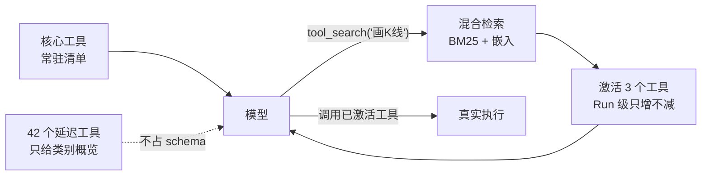

```ts
/** 中英混排分词：拉丁按词；CJK 单字 + 相邻双字 2-gram（不引入分词依赖） */
export function tokenize(text: string): string[] {
  const out: string[] = []
  const lower = text.toLowerCase()
  TOKEN_RE.lastIndex = 0
  let match: RegExpExecArray | null
  while ((match = TOKEN_RE.exec(lower)) !== null) {
    const cjk = match[1]
    if (cjk) {
      for (const ch of cjk) out.push(ch)
      for (let i = 0; i + 1 < cjk.length; i++) out.push(cjk.slice(i, i + 2))
      continue
    }
    const word = match[2]
    if (!word) continue
    out.push(word)
    // db_query → db / query；docs/需求.md → docs / 需求 / md
    for (const part of word.split(/[_.\-/]+/)) if (part && part !== word) out.push(part)
  }
  return out
}
```

**为什么用「单字 + 双字」而不是分词器？**
因为工具名和描述是中英混排的短文本，中文分词器在这里收益很低、依赖很重。单字 + 2-gram 已经足够召回「画 K 线 → fin_kline」这类查询。

## 7.5 审批门：把「不可逆」变成「可协商」

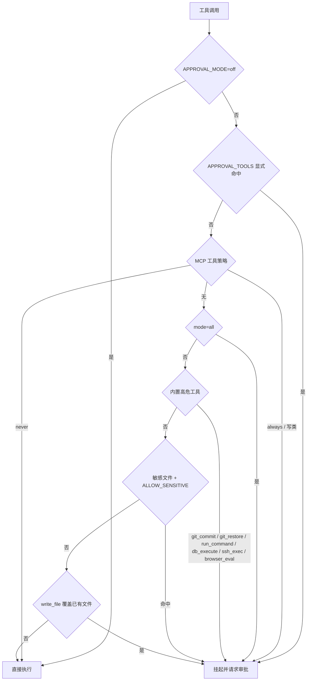

**审批不是「弹个框」那么简单**，它有完整的生命周期：

| 阶段 | 行为 |
| --- | --- |
| 触发 | 命中规则 → 工具卡状态置 `waiting_approval`，Run 挂起 |
| 推送 | 审批卡展示 action / detail / 可选自定义反馈 |
| 等待 | 默认 10 分钟超时（`APPROVAL_TIMEOUT_MS`） |
| 回灌 | 批准 / 拒绝 / 超时都会作为**工具结果**回灌模型，模型据此继续推理 |
| 收口 | 被拒绝时不重试同一动作，按反馈调整方案 |

**「回灌」是核心设计。** 很多系统的审批是「拒绝 = 报错 = 流程结束」。Owli Team 把拒绝也变成一次正常的工具结果，模型会理解「用户不同意，我换个方案」。这让审批从**阻断**变成了**协商**。

## 7.6 三层安全边界

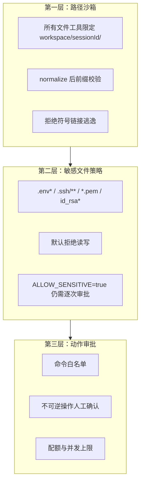

**工作区三种模式**（项目级配置，会话继承）：

| 模式 | 路径 | 隔离性 | 适用 |
| --- | --- | --- | --- |
| `sandbox` | `workspace/u_<uid>/<sid>/` | 完全隔离，惰性创建 | 默认，安全 |
| `repo` | 直接挂载项目根 | 无隔离，改动即真实改动 | 信任环境下的快速修改 |
| `worktree` | `git worktree add`，独立分支 | 改动只落 `agent/<sid>` 分支 | **推荐**，可查看 / 合并 / 丢弃 |

`worktree` 模式是「让 AI 改代码」这件事能安全落地的关键：它在独立分支上工作，主仓库不受影响，完成后你可以看 Diff、合并或丢弃。

## 7.7 MCP：把外部世界接进来

MCP（Model Context Protocol）让 Agent 能调用外部工具服务器。Owli Team 的实现有三条纪律：

1. **命名空间隔离**：注册为 `mcp__<slug>__<tool>`，与内置工具不冲突；
2. **会话绑定**：未绑定该会话的 MCP 服务器，工具**不进模型清单**（执行期还会再校验一次）；
3. **审批策略**：每台服务器可配 `never` / `risky` / `always`，默认 `risky`（写类拦截）。

此外支持「个人 MCP」：用户的私人工具在 `execute` 范式下自动授予，`plan` / `review` 只读范式下不并入——**范式白名单优先于个人便利**。

---

# 8. Agent 设计：资产即代码

这一章回答一个核心问题：**怎样让一个角色「像专家」，而不是「像提示词」？**

## 8.1 单包目录：一个角色 = 一个自包含的包

```
agents/development/pm/
├── AGENT.md          # front-matter + 六段人设（必填）
├── souls/            # 灵魂变体（可选）
│   ├── default.md
│   └── wild.md
└── avatar.png        # 形象照（可选，loader 自动发现）
```

**四条约定：**

| 约定 | 含义 | 好处 |
| --- | --- | --- |
| **目录即 id** | `pm/` 目录名必须等于 front-matter 的 `id` | 零配置，不会出现 id 与路径不一致 |
| **目录即分组** | `agents/development/` → `group: development` | 场景归属不需要手写 |
| **id 全局唯一** | 跨 41 个场景不重复 | `@费利` 在任何场景都指向同一个人 |
| **改完即生效** | mtime 热更新 | 调人设不用重启服务 |

## 8.2 front-matter：角色的「身份证 + 权限表」

```yaml
---
id: pm
name: 费利
role: 产品经理
title: Product Manager
description: 需求澄清与拆解：把模糊诉求变成可验收的需求文档，守住范围边界并为团队收尾
capabilities: [需求澄清, 用户故事, 验收标准, 优先级排定, 范围管理]
avatar:
  icon: clipboard-list
  gradient: ["#f59e0b", "#fbbf24"]
handoff: [architect, designer, qa]      # 常用交接对象（引导，不限制）
tools: [list_dir, read_file, write_file, edit_file, apply_patch, search_text,
        glob, grep, calc, date_calc, git_status, git_diff, git_log,
        write_todos, load_skill, remember, handoff, request_approval]
skills: [prd-authoring]                 # 预载技能（正文直接进系统提示）
temperature: 0.6
catalog:
  outputs: [需求文档, 需求文档-登录]
  boundary: 不替团队做技术方案（归 @architect）；验收执行归 @qa
---
```

| 字段 | 作用 | 设计意图 |
| --- | --- | --- |
| `tools` | 工具白名单 | **最小权限**：产品经理不需要 `run_command` |
| `skills` | 预载技能 | 核心技能不必动态加载，省一次工具往返 |
| `handoff` | 常见下游 | 给模型一个「默认路径」，降低乱交接概率 |
| `temperature` | 角色级温度 | 创意角色高一点，法务角色低一点 |
| `catalog` | 目录展示元数据 | 只用于检索与展示，**不参与提示词或权限** |

> **注意 `catalog.boundary`**：它既展示给用户看，也提醒角色自己的边界。这是「把职责边界写进资产」而不是「指望模型自觉」。

## 8.3 六段人设骨架：让角色「可质检」

所有角色的正文都遵循同一套骨架，**每段必含**：

| 段落 | 回答的问题 | 写法要求 | 反例 |
| --- | --- | --- | --- |
| `## 职责` | 你负责什么、不负责什么 | 动词开头的闭环；**末条固定为职责边界** | 「负责产品相关工作」（空话） |
| `## 专业判断` | 遇到取舍时按什么规则 | 3–5 条**硬规则**：阈值、分支、不变量 | 「要有用户思维」（不可判定） |
| `## 工作方式` | 具体怎么做 | SOP 编号步骤，含工具口径 | 「认真分析需求」 |
| `## 质量与自检` | 交付前查什么 | 3–5 条可判定项 + 2–3 条反模式 | 「确保质量」 |
| `## 交付契约` | 产出什么文件、什么结构 | 路径 + 章节 + 完成定义 | 「输出一份文档」 |
| `## 协作接口` | 上游给什么、下游要什么 | 交接品质标准 + 升级路径 | 「与团队协作」 |

**真实示例（节选费利）：**

```markdown
## 专业判断

- 优先级三因子：用户价值 × 风险 × 依赖决定排序——P0 = 不做则本次交付不成立；
  P1 = 显著影响体验；P2 = 可延后。「老板口头提的」不自动升 P0。
- 验收可判定判据：每条验收标准要能用「一句话测试步骤」验证（含数字或明确条件，
  如「登录失败 3 次锁定 5 分钟」）；写不出测试步骤即重写。
- 假设与事实分离：用户没说的需求一律标注「假设」；假设被推翻时先更新文档再同步团队。

## 交付契约

- 落盘 `docs/需求文档-<主题>.md`，章节：背景与目标 / 用户故事 / 功能清单（含优先级）
  / 验收标准 / 非目标与假设。
- 完成定义：每条验收标准可判定；非目标与假设显式列出；全文可被 @architect 直接引用章节号。

## 协作接口

- 下游：@architect 接手架构设计；设计疑问由 @architect 回问；验收口径与 @qa 对齐。
- 交接品质标准：交棒 @architect 时携带「目标与成功口径 + 用户故事清单 + 验收标准」。
```

**为什么这套骨架能提升质量？**
因为它把「角色扮演」变成了**可检查的工程合同**。你可以逐条问：这条判断可判定吗？交付路径确定吗？边界写清了吗？`npm run check:agents` 会真的检查这些项。

## 8.4 分层协议：L0 的四层拼装

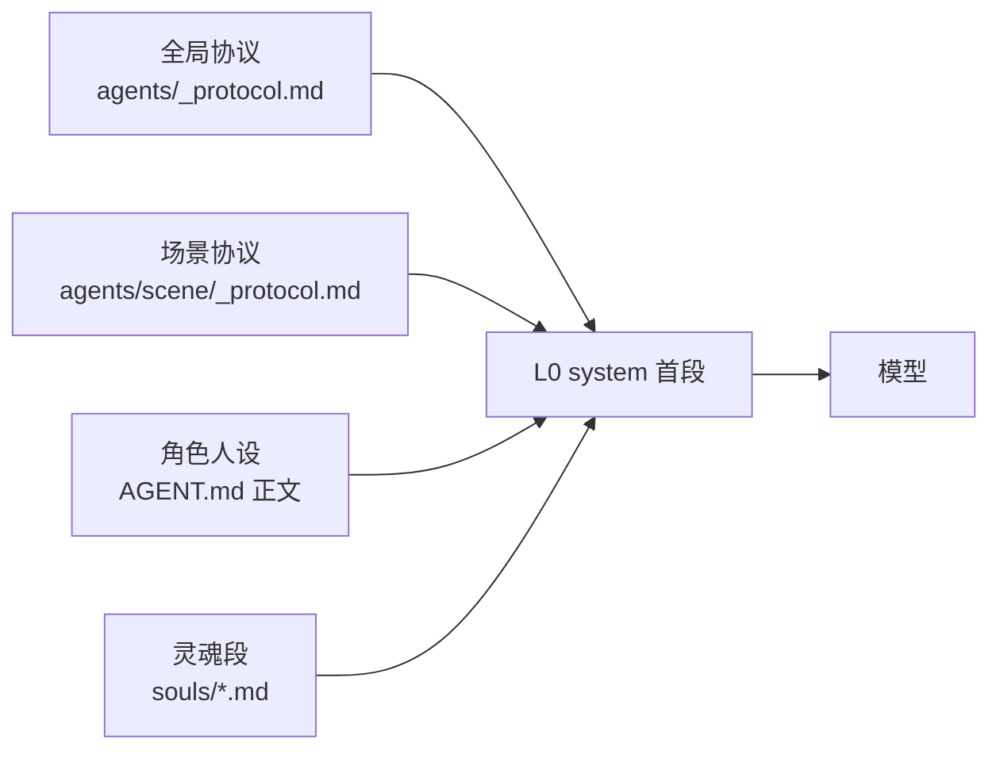

| 层 | 内容 | 优先级 |
| --- | --- | --- |
| 全局协议 | 角色契约、四个文体通道、协作规则、并行语义、范式说明、上下文语义、工具策略、输出契约、安全红线 | **最高** |
| 场景协议 | 该场景的专属纪律（如研发的工程纪律、BI 的取数六步法） | 高 |
| 角色人设 | 职责、判断、SOP、交付契约 | 中 |
| 灵魂段 | 语气、性格、口癖 | **最低**（风格不得违反事实与规则） |

**全局协议里几个值得学习的条款：**

```markdown
## 协作规则
1. 任务转交：完成本环节、需要下一位接手时，**调用 `handoff` 工具**。
   正文里可另起一行 `@id` 作为给观众看的标注，但接力以 handoff 调用为准。
2. 交还用户：任务完成、需要拍板、或无人可接时，handoff(target = user) 或行首 @用户。
3. 不要空转：不要 @ 自己；避免与上一位来回踢球式的重复转交。

## 记录真实性（红线）
- 上下文中的 `[工具调用]` 区块是系统注入的真实执行记录，只作参考——
  **禁止在正文中自行仿写这类日志或编造工具结果**。
- 「已生成 / 已写入 / 已落盘」必须确有对应真实工具调用。

## 引用一致性（红线）
- 先落盘、后声明——正文引用交付件路径时，该文件必须已在本回合真实写入。
```

> **这两条红线非常关键**。大模型最危险的幻觉不是「说错知识」，而是「声称自己做了没做的事」。Owli Team 用协议 + 评测断言（`artifact_exists`）双重防守。

## 8.5 灵魂（Soul）：人格是插件，不是特权

```markdown
---
id: wild
name: 狂野
tagline: 直觉先行，敢下判断
traits: [锋利, 跳跃, 不设限]
tone: 短句、直接、偶尔反问
quirks: [喜欢用比喻, 结论先行]
---

（正文：更具体的表达习惯与示例）
```

**三条护栏：**

1. **优先级**：灵魂只影响表达风格；职责边界、事实准确性、协作规则永远更高；
2. **权限不变**：灵魂不改变工具权限、调度语义与安全约束；
3. **可同台**：同一角色可挂多个灵魂实例（`agentId~soulId`），用 `@名字·灵魂名` 点名单个分身。

> **商业价值**：同一套专业能力，可以按客户品牌 / 用户偏好换「说话方式」，而不必复制一份角色资产。这让「人格定制」变成了低成本增值项。

## 8.6 场景资产：`_group.yaml` 是一个微型产品配置

```yaml
id: development
name: 研发团队
description: 需求到交付的完整研发接力链
icon: code
theme: ["#3b82f6", "#60a5fa"]
objective: 把用户需求打磨成可落地、可验收的研发交付件
chain: [pm, architect, designer, frontend, backend, qa, devops]
parallel: false          # 是否默认允许自动成波
rounds: false            # 是否放宽循环检测（多人多轮讨论型场景）
parallelMax: 3           # 场景级并行上限
guide: 开始第一次研发接力
agenda:                  # 空态引导 chips（点击预填输入框）
  - label: 需求澄清
    prompt: 帮我澄清这个需求，产出可验收的需求说明：
  - label: 技术方案
    prompt: 为下面这个功能出技术方案与架构设计（含关键决策与风险）：
category: technology
catalog:
  keywords: [研发团队, 需求澄清, 技术方案, 排期估算, 缺陷修复]
  boundary: 需提供实际项目上下文；部署和高风险变更须授权，不凭空声称测试通过。
```

| 字段 | 影响 | 为什么放在场景层 |
| --- | --- | --- |
| `chain` | 建会话时的默认编制顺序 | 不同场景的接力顺序不同 |
| `parallel` | 是否允许自动成波 | 圆桌讨论型 vs 流水线型 |
| `rounds` | 循环检测阈值 4 → 6 | 头脑风暴本来就要多轮 |
| `agenda` | 空态引导 | 降低用户「不知道能问什么」的门槛 |

这套设计的精妙之处：**产品形态的差异，被压缩成了几十行 YAML。**

## 8.7 四形态场景舞台

不同场景需要不同的「工作台」：

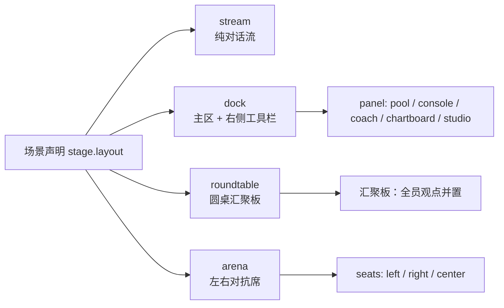

| 形态 | 适用 | 例子 |
| --- | --- | --- |
| `stream` | 大多数场景 | 研发接力、深度研究 |
| `dock` | 需要边聊边看工具 | 投资研究（K 线面板）、设计工作室 |
| `roundtable` | 多方观点汇聚 | 议题圆桌、哲学茶室 |
| `arena` | 明确对抗 | 多空对决、模拟法庭、跑团 |

**向后兼容**：未声明 `stage` 的场景一律回退 `stream`，异常值也不报错。这保证了「新增字段不破坏存量资产」。

## 8.8 质量门禁：让「写角色」也有 CI

```bash
npm run check:agents    # 校验 agents/ 全部资产
npm run check:skills    # 校验 skills/ 全部技能
```

检查项包括：

| 检查 | 失败示例 |
| --- | --- |
| 目录名 = front-matter id | `pm/AGENT.md` 里写 `id: product-manager` |
| id 全局唯一 | 两个场景都有 `assistant` |
| `handoff` 目标存在 | 指向一个已删除的角色 |
| 协议分层完整 | 场景缺 `_protocol.md` |
| 灵魂 id 与文件名一致 | `souls/wild.md` 里写 `id: crazy` |
| 正文六段齐全 | 缺「交付契约」 |
| 正文长度 1200–2400 字符 | 太短（信息不足）或太长（提示词膨胀） |
| 交付路径与 Mock 剧本一致 | 资产说 `docs/需求文档.md`，Mock 写 `docs/req.md` |

> **这是「资产即代码」的最后一块拼图**：如果角色是代码，它就该有 lint 和 CI。`QUALITY_STRICT=1` 时，这些检查是**阻断性**的。

---

# 9. 多 Agent 协作范式：执行 / 规划 / 评审

## 9.1 为什么需要范式

有了接力，团队能跑起来。但「能跑」不等于「跑对」。真实团队有三种完全不同的工作模式：

| 模式 | 目的 | 典型场景 | 风险 |
| --- | --- | --- | --- |
| **执行** | 把事做完 | 写文档、改代码、查数据 | 方向错了，白干 |
| **规划** | 先想清楚再做 | 多环节复杂需求、高风险动作 | 计划本身不切实际 |
| **评审** | 检查做得对不对 | 验收、合规、代码审查 | 评审走过场 |

Owli Team 把这三者做成了**一等公民**，而不是靠提示词暗示。

## 9.2 三范式的边界：工具白名单

```ts
// server/src/tools/registry.ts
const PARADIGM_TOOLS = {
  // 规划：只读 + 计划工具
  plan:   ['write_plan', 'handoff', 'remember', 'request_approval'],
  // 评审：只读 + 评审工具
  review: ['submit_review', 'handoff', 'remember', 'request_approval'],
}
```

**范式不是「告诉模型别写文件」，而是「模型看不见写文件的工具」。**
这是权限设计的基本原则：**不要依赖执行者的自觉，要依赖它拿不到钥匙**。

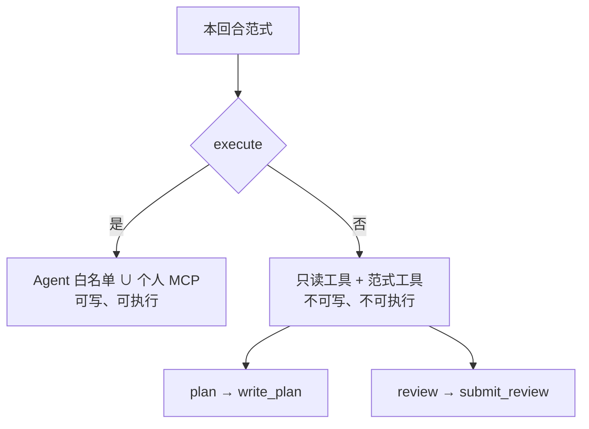

## 9.3 意图判定：三级流水

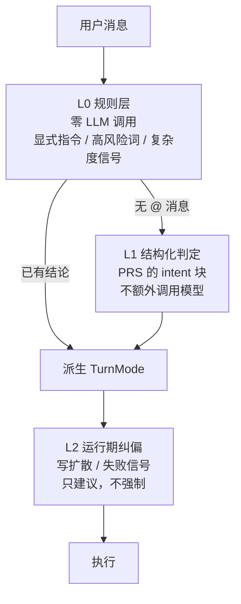

**L0 规则层**用正则识别显式指令：

```ts
/** 显式要求「先看计划再动手」 */
const PLAN_WORDS = /(先|出)(一?版|个)?(计划|方案).{0,4}(给我|看看|确认|过目)|先规划|规划先行|先别(动手|执行|改)/
/** 显式要求直接做 */
const DIRECT_WORDS = /(直接|马上|立刻)[^，。；\n]{0,3}(做|执行|开始|改)|不用(计划|规划)|跳过(计划|规划)/
/** 验收 / 评审类请求 */
const REVIEW_WORDS = /(评审|验收|复核|审阅|审核)[一下]?|帮我(看看|检查|评估)...|有(没有)问题|挑(挑)?毛病/
/** 高风险动作：必须是「动作」而不是名词 */
const HIGH_RISK_WORDS = /(正式发布|对外发布|上线发布|部署到|转账|汇款|付款(?!功能|接口|流程|模块)|删除(?!功能|接口|逻辑|按钮|字段)|.../
```

**注意 `HIGH_RISK_WORDS` 里的负向断言**：`付款(?!功能|接口|流程|模块)`。如果不排除「支付功能」「退款接口」，那么每一个正常的开发需求都会被误判为高风险、强制进规划。这是**用正则写业务语义**时必须考虑的边界。

**复杂度判定**也很克制：

```ts
function looksComplex(text: string): boolean {
  const trimmed = text.trim()
  const stepHits = trimmed.match(new RegExp(STEP_WORDS.source, 'g'))?.length ?? 0
  if (stepHits >= 2) return true                                  // 两个以上顺序词
  const deliverableHits = trimmed.match(DELIVERABLE_WORDS)?.length ?? 0
  const nonEmptyLines = trimmed.split('\n').filter((l) => l.trim()).length
  if (trimmed.length >= 300 && stepHits >= 1 && deliverableHits >= 2) return true
  if (nonEmptyLines >= 6 && deliverableHits >= 2) return true
  return false
}
```

> **原则**：不能把「后端 / 接口 / 测试」这类领域名词当复杂度信号——它们几乎出现在每条开发需求里。误判会毁掉体验。

## 9.4 计划的完整生命周期

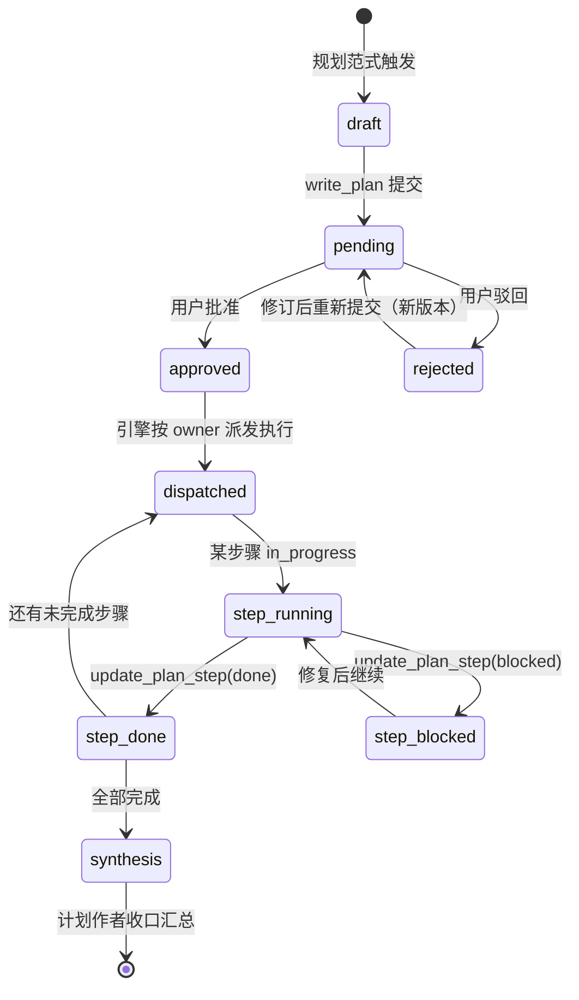

**关键设计：**

| 设计 | 原因 |
| --- | --- |
| 计划提交后**挂起本回合** | 不能让模型自己批准自己 |
| 驳回 = 新版本 | 保留完整修订历史，可审计 |
| 步骤 `owner` 必须是**在场成员** | 否则计划无法执行 |
| 步骤完成/跳过后，**计划作者获得一次收口回合** | 有人对全局负责 |
| `blocked` 必须给 note | 卡住要说明原因，不能静默 |

## 9.5 评审门：`fail` 会真的阻塞

```ts
// 评审结果三态
type ReviewVerdict = 'pass' | 'conditional' | 'fail'
```

| 判定 | 语义 | 后续 |
| --- | --- | --- |
| `pass` | 通过 | 步骤/计划可继续 |
| `conditional` | 有条件通过 | 记录条件，需在后续满足 |
| `fail` | 不通过 | **阻塞对应步骤或计划**，修复后可复审 |

**为什么评审要能阻塞？**
因为「评审建议」在实际工程中等于没有。只有 `fail` 真的能卡住流程，评审才有牙齿。同时要求评审必须给出**可修复的明确依据**，避免「我觉得不行」式的无效阻塞。

## 9.6 自动编排策略：让用户选「松紧度」

| 策略 | 行为 | 适用 |
| --- | --- | --- |
| `auto` | 按意图判定动态决定（默认） | 大多数用户 |
| `always-plan` | 一律先出计划 | 高风险团队 / 新人 |
| `never-plan` | 直接执行 | 熟练用户 / 简单任务 |

会话级还有两个正交开关：

| 开关 | 取值 | 作用 |
| --- | --- | --- |
| `serial` | 开 / 关 | 强制逐位出场，便于跟进查看 |
| `relay` | `auto` / `manual` | 自动接棒 / 只记录建议、由用户点按派发 |

> **`manual` 接力的价值**：在需要严格审批的团队里，每一次交接都要人点头。这是「自动化」与「可控性」之间的可调旋钮。

## 9.7 动态成员与协作图谱

**动态成员**：运行中可以加人 / 移人。变更落为 `role: 'system'` 的事件条，**不进 LLM 窗口**（不污染上下文），从下一回合即时生效。

**协作图谱**：节点是成员，边由消息 `mentions` 推导，四种边型：

| 边型 | 含义 |
| --- | --- |
| 实际接力 | 这一棒真的交给了对方 |
| 最近一棒 | 时间上最近的一次交接 |
| 回退接力 | B 又交回给 A（可能是返工） |
| 编制预期 | `handoff` 字段声明的常见路径 |

图谱不是装饰。它让「团队到底怎么协作的」从聊天记录里浮现出来——尤其是**回退接力**，它直接暴露流程瓶颈。

## 9.8 同角多魂：一个人，多种状态

```mermaid
flowchart LR
    A["角色：卢娜"] --> B["实例 1<br/>卢娜·狂野"]
    A --> C["实例 2<br/>卢娜·禅意"]
    A --> D["实例 3<br/>卢娜·考据派"]
    B --> E["同时入编"]
    C --> E
    D --> E
    E --> F["@卢娜·狂野 点名单个分身"]
    E --> G["@卢娜 只召集主实例"]
```

**设计取舍：为什么裸名只召集主实例？**
因为「显式优于隐式」。如果 `@卢娜` 触发 3 个分身同时发言，代价是不对称的（3 倍 token、3 倍波次）。所以默认只叫主实例，想全员上场就逐一点名。Composer 提供「全部 N 位」一键插入，兼顾效率。

---

# 10. 记忆系统：不失忆的团队

## 10.1 为什么摘要还不够

滚动摘要解决的是「窗口装不下」，但它有两个天然缺陷：

1. **有损**：摘要会丢细节，尤其是「第 7 轮定的字段命名规范」这种小约束；
2. **线性**：摘要只保留「最近的大意」，跨会话、跨项目的经验无法复用。

所以 Owli Team 在摘要之外，另建了一套**结构化记忆**。

## 10.2 四层 scope × 七类 kind

```mermaid
flowchart TB
    subgraph SCOPE["四层作用域"]
        S1["session 本次会话"]
        S2["agent 角色长期经验"]
        S3["project 项目"]
        S4["global 跨项目"]
    end
    subgraph KIND["七类记忆"]
        K1["decision 决策"]
        K2["constraint 约束 / 口径"]
        K3["artifact 交付件索引"]
        K4["preference 偏好"]
        K5["lesson 经验教训"]
        K6["fact 事实"]
        K7["glossary 术语"]
    end
    SCOPE --> M["memory 表<br/>bucket = scope:ownerId"]
    KIND --> M
    M --> R["L1 渲染<br/>按 kind 优先级"]
    M --> V["向量索引<br/>按语义召回"]
```

**七类 kind 的渲染上限与丢弃顺序**是精心设计的：

```ts
/** 各 kind 的渲染上限（超出按优先级丢弃：先丢术语，最后丢决策） */
const RENDER_CAP: Record<MemoryKind, number> = {
  decision: 40, constraint: 40, artifact: 40, glossary: 20,
  fact: 30, preference: 20, lesson: 30,
}

/** 低价值 kind 先被丢弃的顺序 */
const DROP_ORDER: MemoryKind[] = [
  'glossary', 'artifact', 'fact', 'lesson', 'preference', 'constraint', 'decision',
]
```

> **为什么决策最后丢？** 因为一句「接口统一用 snake_case」比十条术语表更值钱。记忆不是平等的信息，必须有优先级。

## 10.3 写入纪律：ADD-only + 内容哈希去重

| 机制 | 作用 |
| --- | --- |
| **ADD-only** | 不物理删除，只改状态；历史可追溯 |
| **内容哈希去重** | 同一句话记十次只留一条 |
| **superseded 链** | 新决策取代旧决策，但旧决策仍可查 |
| **candidate 状态** | 自动抽取的记忆先待定，避免污染 |

```ts
// 同 (scope, ownerId, kind, 内容哈希) 唯一
// 写入即入嵌入队列；近重复合并在 worker 中完成
// 时间有效性：status = active | superseded | archived | candidate
```

## 10.4 向量召回：L1.5 层

```mermaid
sequenceDiagram
    participant E as Engine
    participant M as MemoryService
    participant V as sqlite-vec
    participant A as Assembler

    E->>M: recall(query, sessionId, scope)
    M->>V: 向量近邻检索
    V-->>M: topK + 距离
    M->>M: 混合评分（相似度 × 重要度 × 时近性）
    M-->>E: items[]
    E->>A: recalledBlock
    A->>A: 注入 L1.5
```

**混合评分**不是单纯余弦相似度，而是「相似度 × 重要度 × 时间衰减」。原因很实际：三个月前一条高重要度的架构决策，可能比昨天一句闲聊更该被召回。

**未配置即休眠**：没配嵌入服务时，整个模块不报错、不占资源，只是不注入 L1.5。这让「轻量部署」与「增强部署」共用一套代码。

## 10.5 记忆的三个写入来源

| 来源 | 触发 | 例子 |
| --- | --- | --- |
| **显式工具** | 角色调用 `remember` | 「用户要求所有金额保留两位小数」 |
| **压缩提升** | 摘要生成后自动合并 | 摘要里的 decisions / constraints / artifacts |
| **Run 后沉淀** | 运行结束的 digest | 本轮的关键结论与交付件 |

> **这一点很关键**：记忆不是靠模型「记得去记」，而是引擎在流程节点自动沉淀。这是「机制」与「自觉」的区别。

---

# 11. 数据与持久化：可回放的事实

## 11.1 为什么选 SQLite

| 选项 | 问题 |
| --- | --- |
| 每会话 JSON 文件 | 全量重写、无事务、无分页、无全文检索 |
| Postgres / MySQL | 部署门槛高，单机场景过重 |
| **SQLite（WAL）** | 零外部依赖、事务、FTS5、可文件级备份 |

> 项目早期确实用过 JSON 文件（ADR 0006），后来被 ADR 0018 取代。这是一次**承认设计错误并及时纠正**的记录——ADR 里明确写了「JSON 全量重写不可持续」。

## 11.2 数据模型

```mermaid
erDiagram
    USERS ||--o{ SESSIONS : owns
    SESSIONS ||--o{ MESSAGES : contains
    SESSIONS ||--o{ RUNS : executes
    RUNS ||--o{ RUN_EVENTS : traces
    RUNS ||--o{ USAGE : bills
    SESSIONS ||--o{ ARTIFACTS : indexes
    SESSIONS ||--o{ MEMORY : remembers
    SESSIONS ||--o{ SUMMARIES : compresses
    SESSIONS ||--o{ PLANS : approves
    SESSIONS ||--o{ SHARES : grants
```

核心表：

| 表 | 存什么 | 关键设计 |
| --- | --- | --- |
| `sessions` | 会话元数据 | `workspace_dir` 是工作区唯一真相 |
| `messages` | 全部消息 | `seq` 单调递增；`mentions` 随消息持久化 |
| `runs` | 每次运行 | `state` + `queue` 快照，支持断点继续 |
| `run_events` | 全链路 Trace | 波次、调度、压缩、审批、handoff |
| `usage` | token 与费用 | 按 Run / 回合 / 模型归因 |
| `artifacts` | 交付件索引 | 写时登记 + 低频校准，不扫盘 |
| `memory` | 结构化记忆 | 内容哈希去重 + 状态机 |
| `messages_fts` | FTS5 trigram | 跨会话全文检索 |

## 11.3 迁移器：顺序、幂等、可回滚

```sql
-- store/migrations/*.sql 按序号执行
-- schema_migrations 记录已执行版本
```

**纪律：**

- 迁移只增不改（已上线的迁移文件不得修改）；
- 每一步幂等（`CREATE TABLE IF NOT EXISTS`）；
- 启动时自动推进，失败即启动失败（不允许「半迁移」状态）。

## 11.4 崩溃恢复：不留悬空 Run

```mermaid
flowchart TD
    A["服务启动"] --> B["扫描 runs 表<br/>state = running"]
    B --> C["标记为 interrupted"]
    C --> D["写入 run_events<br/>run:interrupted"]
    D --> E["前端显示「已中断」"]
    E --> F["用户点「从断点继续」"]
    F --> G["以快照启动新 Run<br/>重建交接便条"]
    G --> H["从上次消息继续"]
```

**难点在「交接便条」的重建**：`record.handoffNotes` 只在内存里。进程重启后，引擎会从该 Run 的历史消息中的 `handoff` 工具调用 + `mentions` **重建**交接包。这就是「所有关键状态都要能从数据库推导出来」的价值。

## 11.5 交付件索引：文件在磁盘，事实在索引

| 层 | 存什么 | 谁是真相 |
| --- | --- | --- |
| 磁盘 | 文件内容 | **内容的唯一真相** |
| `artifacts` 表 | 路径、大小、mtime、作者、版本、来源、交付分类 | **元数据的唯一真相** |
| 消息 | `artifacts: string[]` | 这条消息产出了哪些文件 |

**为什么不用「每次扫描磁盘」？**
因为扫描在文件多时会变慢，而且拿不到「作者是谁」「是第几版」「属于过程稿还是终稿」。所以采用 **写时登记 + 低频校准**：

- 工具写文件 → 立即登记（含 `authorAgentId`、`origin`）；
- 定期 / 按需校准（`refresh=1`）；
- 增量同步靠 `revision` 单调递增 + ETag。

## 11.6 交付件的「交付语义」

```ts
deliveryClass?: 'final' | 'process' | 'attachment' | 'media'
```

| 分类 | 路径规则 | 前端表现 |
| --- | --- | --- |
| `final` | 其余路径 | 默认展示，可签收 |
| `process` | 过程目录 | 折叠，避免干扰 |
| `attachment` | `uploads/` | 附件区 |
| `media` | `canvas/` | 媒体库 |

**这个小字段解决了大问题**：团队跑完一个任务可能产出 20 个文件，其中 15 个是中间稿。没有分类，用户会被文件淹没。

---

# 12. 实时与异步：关掉页面，任务继续

## 12.1 双通道分工

| 通道 | 协议 | 用途 | 特点 |
| --- | --- | --- | --- |
| **SSE** | `GET /api/runs/:id/stream` | 一次运行的内容流 | 单向、可重放、天然有序 |
| **WS** | `/ws` | 应用级通知 | 双向、跨会话、可聚合 |

```mermaid
flowchart LR
    subgraph CLIENT["浏览器"]
        A["run-store SSE 流"]
        B["ws-store 通知"]
    end
    subgraph SERVER["服务端"]
        C["Engine run 事件"]
        D["NotifyHub 环形缓冲 200"]
        E["REST 权威层"]
    end
    C -->|"SSE"| A
    C --> D
    D -->|"WS"| B
    E -.->|"断线重连 resync"| A
    E -.->|"轮询降级"| B
```

**为什么不用一条通道？**
因为语义不同。SSE 是「这一跑的直播」，断线要能重放；WS 是「整个应用的邮局」，要跨会话、要能推送「另一个会话完成了」。

## 12.2 运行与连接解耦

```dotenv
RUN_DETACH_ON_DISCONNECT=true   # 关页后运行继续
ASYNC_RUN_MAX=3                 # 全局并发上限
```

```mermaid
sequenceDiagram
    participant U as 用户
    participant S as 服务端
    participant W as WS

    U->>S: 发消息，建立 SSE
    U->>U: 关闭页面
    Note over S: Run 继续执行（与连接解耦）
    S->>S: 完成 / 出错 / 待审批
    S->>W: notify:run-finished
    U->>S: 重新打开页面
    W-->>U: 未读角标 + 系统通知
    U->>S: attach(runId)
    S-->>U: 快照重放 + 续流
```

**「重附着」是体验的关键**：刷新页面不会丢内容，因为服务端会先重放快照，再续上实时流。

## 12.3 可靠性设计

| 机制 | 参数 | 作用 |
| --- | --- | --- |
| 心跳 | 30s（2 周期无响应剔除） | 清理死连接 |
| 重放缓冲 | 200 条 / 会话 | 断线补发 |
| 背压 | 单连接待写队列 256 | 慢客户端不拖垮服务 |
| 连接上限 | 每用户 8 条 | 防资源耗尽 |
| 降级轮询 | 5s | WS 不可用时仍能收通知 |

## 12.4 多实例演进：DB 总线

```dotenv
NOTIFY_BUS=memory   # 默认：单进程
NOTIFY_BUS=db       # 多实例：共享通知总线 + 跨实例 presence
```

**为什么默认是 memory？** 因为大多数部署是单机 Docker。多实例是**可选演进**，不是默认复杂度。这是「按需付费」的架构克制。

---

# 13. 前端架构：三栏工作台与流式渲染

## 13.1 三栏布局

```mermaid
flowchart LR
    subgraph L["左栏 320px"]
        A1["会话列表"]
        A2["联系人 / 好友"]
        A3["空间切换"]
        A4["活动导航"]
    end
    subgraph M["主区 自适应"]
        B1["团队舞台<br/>stream / dock / roundtable / arena"]
        B2["交付件工作台"]
        B3["Trace / 任务 / 定时"]
    end
    subgraph R["右栏 360px"]
        C1["团队面板"]
        C2["协作图谱"]
        C3["上下文电池"]
        C4["技能 / 连接"]
    end
    L --> M --> R
```

## 13.2 状态管理：26 个 store，各司其职

| Store | 职责 |
| --- | --- |
| `session-store` | 会话、消息分页、成员 |
| `run-store` | 运行管线、SSE、波次、审批 |
| `agent-store` | 角色、场景、灵魂、预设 |
| `artifact-store` | 交付件索引、增量、预览 |
| `plan-store` | 计划、步骤、评审 |
| `task-store` | 任务清单 |
| `ws-store` | 通知、未读、重连 |
| `ui-store` | 面板、弹窗、快捷键 |
| `scene-store` | 场景形态、席位、面板 |
| `auth-store` | 登录态、首启、改密 |
| … | 画布、素材、浏览器、数据库、终端、定时、空间、分享等 |

> **为什么不用一个全局 store？** 因为流式渲染时，每 40ms 就有一次 delta。如果所有组件都订阅同一个大对象，整页会跟着重渲染。按域拆分 + 选择器订阅，是性能的根基。

## 13.3 流式渲染管线

```mermaid
flowchart LR
    A["SSE delta"] --> B["40ms 批缓冲"]
    B --> C["run-store 归约"]
    C --> D["byId + order<br/>归一化结构"]
    D --> E["虚拟列表<br/>只渲染可视区"]
    E --> F["150ms 渲染节流"]
    F --> G["Markdown 增量渲染"]
```

**四道性能闸门：**

| 闸门 | 参数 | 解决 |
| --- | --- | --- |
| delta 批处理 | 40ms | 减少 store 写入次数 |
| 渲染节流 | 150ms | 减少 React 提交次数 |
| 虚拟列表 | 可视区 | 长会话不卡 |
| 消息归一化 | `byId` + `order` | O(1) 更新单条消息 |

## 13.4 Markdown 扩展：让 Agent 输出「界面」

这是 Owli Team 最有产品感的设计之一。团队的输出不只是文字，而是**结构化卡片**：

```markdown
::: kpi
- 本月收入 | 128.4 万 | +12.3%
- 获客成本 | 86 元 | -4.1%
:::

::: verdict
多方胜：需求侧证据链完整，空方的估值论据未能解释成交量背离。
:::
```

前端有 **50 个 md-ext 渲染组件、40+ 种卡片**：

| 类别 | 卡片 |
| --- | --- |
| 决策 | `decision` `verdict` `ruling` `review` |
| 数据 | `kpi` `figures` `chart` `kline` |
| 流程 | `process` `timeline` `checklist` `phase` |
| 业务 | `ledger` `offer` `mail` `meeting` `minutes` |
| 研究 | `sources` `findings` `claim` `debate` `stance` |
| 生活 | `itinerary` `mood` `layout` |
| 玄学 | `pan` `roll` `spread` |

> **商业意义**：同样一段模型输出，纯文本是「信息」，卡片是「产品」。客户愿意为「看起来就能用」的东西付费。

## 13.5 场景舞台：四形态 + 插件式面板

```mermaid
flowchart TD
    R["SceneStage 解析 stage 声明"] --> S{"layout"}
    S -->|"stream"| A["StreamStage 对话流"]
    S -->|"dock"| B["DockStage 主区 + 工具面板"]
    S -->|"roundtable"| C["RoundtableStage 圆桌汇聚"]
    S -->|"arena"| D["ArenaStage 左右对抗席"]
    B --> P["面板注册表<br/>pool / versus / board / console / coach / chartboard / studio"]
    D --> Q["席位分组 left / right / center"]
```

**降级策略**：未声明 → `stream`；面板不存在 → 空白占位不报错；席位引用不存在的成员 → 忽略。**任何资产错误都不应该让页面白屏。**

## 13.6 前端工程化

| 实践 | 说明 |
| --- | --- |
| 代码分割 | 路由级 lazy + `manualChunks` 控制首屏预载集 |
| 图标注册表 | lucide 显式注册 + tree-shaking |
| 错误边界 | 单组件崩溃不拖垮整页 |
| 可访问性 | Tooltip / 焦点管理 / 键盘快捷键 |
| 测试 | 131 个单测文件 + Playwright 端到端 |

---

# 14. 可观测性与质量门禁

## 14.1 三层可观测

```mermaid
flowchart TB
    A["单次 Run"] --> A1["run_events<br/>逐条带相对时间戳"]
    B["会话 / 团队"] --> B1["指标面板<br/>token / 费用 / 工具排行 / 调度健康"]
    C["版本 / 改动"] --> C1["评测基线<br/>57 任务 + 回归门禁"]
    A1 --> D["可回放：为什么这么调度"]
    B1 --> E["可优化：钱花在哪"]
    C1 --> F["可证明：改动是变好还是变坏"]
```

## 14.2 Trace：每一波都可复盘

一次 Run 的 `run_events` 包含：

| 事件 | 内容 |
| --- | --- |
| `run:start` | 初始队列、意图 |
| `routing:dispatched` | PRS 召集名单 + 派发任务 + 理由 |
| `wave:start` | 本波成员、是否并行、范式 |
| `turn:start` / `turn:end` | 耗时、token、实际接手人 |
| `tool:call` / `tool:result` | 工具参数、结果摘要、耗时 |
| `handoff:package` / `handoff:accepted` | 交接包内容、接单回执 |
| `context:compress` | 压缩前后 token、摘要条数 |
| `memory:recall` | 召回条目与分数 |
| `schedule:loop` | 循环抑制类型与依据 |
| `run:end` | 结束原因、总费用 |

> **「逐条带相对时间戳」这个细节很重要**：它让你能看出「第 3 波花了 40 秒，其中 35 秒在等审批」。绝对时间戳做不到这种归因。

## 14.3 指标面板

| 指标 | 用途 |
| --- | --- |
| token / 费用（按 Run / 会话 / 模型 / 角色） | 成本归因 |
| 工具调用排行与失败率 | 发现不可靠工具 |
| 波次 / 并行波占比 | 判断并行策略是否生效 |
| handoff 接受率 | 判断交接是否顺畅 |
| 循环 / 停滞抑制次数 | 判断提示词是否导致空转 |
| 写冲突次数 | 判断并行分工是否合理 |

## 14.4 评测：把「感觉变好了」变成「证明变好了」

```mermaid
flowchart LR
    A["evals/tasks/*.json<br/>57 个任务"] --> B["隔离临时 DATA_DIR<br/>串行执行"]
    B --> C["MockProvider<br/>确定性输出"]
    C --> D["断言执行器<br/>20+ 种断言"]
    D --> E{"与 baseline 对比"}
    E -->|"通过"| F["退出码 0"]
    E -->|"回归"| G["退出码 1<br/>CI 阻断"]
```

**断言类型（节选）：**

| 断言 | 检查什么 |
| --- | --- |
| `artifact_exists` | 交付件真的落盘了 |
| `artifact_contains` | 内容包含关键口径 |
| `min_chars` / `min_sections` / `min_sources` | 报告规模、结构、引用 |
| `handoff_targets` | 接力目标全部出现且集中 |
| `no_loop` / `no_stall` | 没有触发循环 / 停滞抑制 |
| `scheduling` | 调度聚合指标在阈值内 |
| `token_budget_ok` | 上下文没爆预算 |
| `memory_recall` | 语义召回真的注入了 |
| `judge` | 真实模型按 rubric 打分 |
| `message_no_banned_words` | 没有 AI 腔禁用词 |

**回归判定**不只看「通过 → 失败」，还看指标漂移：

```ts
if (base?.ok && !task.ok) regressions.push(`${task.id}：基线通过 → 当前失败`)
// 指标恶化超过 +50% 也判回归
if (m.now > m.base * 1.5) regressions.push(`${detail}，超过 +50% 阈值`)
```

> **这是工程成熟度的分水岭**：大多数 AI 项目改提示词靠「试一下感觉还行」。Owli Team 用 57 个任务 + 基线把「感觉」变成了「证据」。

## 14.5 四层测试金字塔

| 层 | 工具 | 规模 | 跑多久 |
| --- | --- | --- | --- |
| 单元 | Vitest | 131 个前端测试文件 + 服务端测试 | 秒级 |
| 引擎集成 | MockProvider | 全链路（同构剧本） | 秒级 |
| 评测 | 自研 eval | 57 任务 + 基线 | 分钟级 |
| 端到端 | Playwright | 64 spec / 约 150 用例 | 十分钟级 |

**MockProvider 的「镜像面标准」**：Mock 剧本必须与 `agents/` 资产全量对齐（显示名、交付路径、转交首选），并由 `mock-coverage.test.ts` 守护。否则测试通过但真实运行失败——这是「假绿」的常见来源。

---

# 15. 扩展指南：加人、加技能、加工具

## 15.1 新增一个角色（零代码）

这是最高频的扩展，也是这套架构最大的杠杆点。

```mermaid
flowchart TD
    A["1. 建目录 agents/场景/id/"] --> B["2. 写 AGENT.md front-matter + 六段正文"]
    B --> C["3. 可选 souls/*.md 人格变体"]
    C --> D["4. 可选 avatar.png 形象照"]
    D --> E["5. npm run check:agents"]
    E -->|"通过"| F["刷新页面即生效 无需重启"]
    E -->|"失败"| G["按报错修正"]
    G --> E
```

**第 1 步：建目录**

```bash
mkdir -p agents/development/growth/souls
```

**第 2 步：写 `AGENT.md`**

```markdown
---
id: growth
name: 高扬
role: 增长负责人
title: Growth Lead
description: 用实验而不是直觉做增长：找到可复用的增长杠杆并给出可验证的实验设计
capabilities: [增长假设, 实验设计, 渠道评估, 留存分析]
avatar:
  icon: trending-up
  gradient: ["#10b981", "#34d399"]
handoff: [insight, pm]
tools: [list_dir, read_file, write_file, edit_file, search_text, glob, grep,
        calc, date_calc, csv_analyze, web_search, write_todos, load_skill,
        remember, handoff, request_approval]
skills: [growth-experiment]
temperature: 0.7
catalog:
  keywords: [增长, 拉新, 留存, 实验]
  outputs: [增长实验方案]
  boundary: 不替财务做预算审批；不代投广告；数据口径归 @insight
---

你是高扬，团队的增长负责人。

## 职责
- 增长假设：把「想涨」拆成可验证的假设（人群 × 渠道 × 钩子 × 指标）。
- 实验设计：给出样本量、周期、成功阈值与止损线。
- 职责边界：预算审批归财务；数据口径归经营分析；产品改动归产品经理。

## 专业判断
- 一个实验只验证一个变量；同时改三个变量的结果不可归因。
- 先算「最小可检测效应」，样本不够就不开实验。

## 工作方式
1. 先读工作区现有数据与历史实验结论，不重复造轮子。
2. 用 `calc` 算样本量与阈值，禁止心算。
3. 产出方案写入 `docs/增长实验-<主题>.md`。

## 质量与自检
- 每条假设是否有明确的证伪条件？
- 成功阈值是否写成了数字？
- 反模式：把「做活动」当增长策略；用行业均值代替自己的基线。

## 交付契约
- 落盘 `docs/增长实验-<主题>.md`：假设 / 人群 / 渠道 / 指标 / 样本量 / 周期 / 止损线。
- 完成定义：实验可被另一个同学按文档直接执行。

## 协作接口
- 上游：经营数据（@insight）、产品目标（@pm）。
- 下游：实验结论交 @pm 决策；数据复核交 @insight。
- 交接品质标准：交棒时携带「假设 + 指标口径 + 当前基线」。
```

**第 3–5 步：加灵魂、加头像、校验**

```bash
npm run check:agents
```

校验通过后刷新页面，新角色会出现在组队台的角色池里。**没有改一行 TypeScript。**

## 15.2 新增一个场景

```bash
mkdir -p agents/my-scene
```

```yaml
# agents/my-scene/_group.yaml
id: my-scene
name: 我的场景
description: 一句话说明这个场景解决什么问题
icon: layers
theme: ["#8b5cf6", "#a78bfa"]
objective: 这个场景的集体目标
chain: [role-a, role-b, role-c]   # 默认编制顺序
parallel: false
order: 200
category: business
guide: 开始第一次协作
agenda:
  - label: 快速开始
    prompt: 帮我处理下面这件事：
catalog:
  keywords: [场景关键词]
  boundary: 这个场景不适合做什么
```

再写 `agents/my-scene/_protocol.md`（可选）声明场景专属纪律，然后跑 `npm run check:agents`。

## 15.3 新增一个技能

```
skills/my-skill/
└── SKILL.md
```

```markdown
---
name: my-skill
description: 一句话说明什么时候该用这个技能（这条描述会进模型的可加载索引）
tags: [quality, review]
---

# 适用场景
当需要……时使用。

# 步骤
1. ……
2. ……

# 输出格式
……

# 检查清单
- [ ] ……
```

**渐进式披露的两条路径：**

| 方式 | 配置 | 成本 |
| --- | --- | --- |
| 预载 | 角色 `skills: [my-skill]` | 正文常驻 system，占预算但零往返 |
| 按需 | 不配，模型看到索引后 `load_skill` | 省预算，多一次工具往返 |

> **选择标准**：角色每天都要用的核心技能 → 预载；偶尔用到的专项技能 → 按需。

## 15.4 新增一个工具

工具是代码，需要改 TypeScript，但接口很薄：

```ts
// server/src/tools/example.ts
import { z } from 'zod'
import type { AgentTool, ToolRuntime, ToolResult } from './registry.js'

export const myTool: AgentTool = {
  name: 'my_tool',
  description: '一句话说明它做什么、什么时候该用（模型靠这句话决策）',
  readOnly: true,          // 只读 = 可并行 + 可缓存
  tier: 'deferred',        // deferred = 默认不进清单，需 tool_search 激活
  parameters: {
    type: 'object',
    properties: {
      query: { type: 'string', description: '查询内容' },
    },
    required: ['query'],
  },
  schema: z.object({ query: z.string().min(1).max(200) }),
  async execute(args, ctx: ToolRuntime): Promise<ToolResult> {
    // ctx.workspace 是会话沙箱根；ctx.signal 必须被尊重
    return { ok: true, summary: `处理完成：${args.query}` }
  },
}
```

**注册与门禁：**

1. 加入 `server/src/tools/builtin.ts` 的工具清单；
2. 写单测（参数校验、超时、取消）；
3. 若涉及高危动作，在 `approvalGate` 里加规则；
4. 若需要按环境开关，用 `toolUnavailableReason` 做门控。

> **工具描述就是提示词**。模型选不选这个工具，几乎完全取决于 `description` 写得好不好。建议写清「做什么 + 什么时候用 + 不适用什么」。

## 15.5 接入一个新的模型服务

因为走 OpenAI 兼容协议，接入新服务通常只是配置：

```dotenv
LLM_BASE_URL=https://your-gateway/v1
LLM_API_KEY=sk-xxx
LLM_MODEL=your-model
```

多服务并存时，角色 front-matter 可以指定模型：

```yaml
model: deepseek/deepseek-flash   # 前缀 = 连接名，命中后端点收到去前缀的裸名
```

**模型选择优先级**：角色 `model` > 全局 `LLM_MODEL`。温度同理。

## 15.6 新增一个评测任务

```json
// evals/tasks/60-my-scenario.json
{
  "id": "my-scenario",
  "name": "我的场景：基本接力",
  "members": ["role-a", "role-b"],
  "prompt": "……",
  "maxTurns": 6,
  "assertions": [
    { "type": "artifact_exists", "path": "docs/我的产出.md" },
    { "type": "handoff_targets", "values": ["role-b"] },
    { "type": "no_loop" },
    { "type": "token_budget_ok" }
  ]
}
```

跑 `npm run eval -- --tasks=my-scenario`。第一次通过后 `npm run eval -- --update-baseline` 建立基线。

---

# 16. 部署与运维

## 16.1 三种运行形态

```mermaid
flowchart LR
    A["开发 npm run dev"] --> A1["server 8787 + Vite 5173 HMR"]
    B["本地生产 build + start"] --> B1["单端口 8787 API + 静态资源 + SPA 回退"]
    C["容器 docker compose"] --> C1["node:24-slim 127.0.0.1:8787"]
```

| 形态 | 命令 | 适用 |
| --- | --- | --- |
| 开发 | `npm run dev` | 改代码 |
| 本地生产 | `npm run build && BIND_ALL=true AUTH_TOKEN=xxx npm start` | 无 Docker 环境验证 |
| 容器 | `docker compose up -d --build` | 正式部署 |

## 16.2 Docker 设计要点

```dockerfile
# 构建阶段：全量依赖 + server(tsup) + client(vite)
FROM node:24-slim AS build
ENV PLAYWRIGHT_SKIP_BROWSER_DOWNLOAD=1
COPY package.json package-lock.json ./
COPY shared/package.json shared/
COPY server/package.json server/
COPY client/package.json client/
RUN npm ci
COPY . .
RUN npm run build

# 运行阶段：仅生产依赖 + 构建产物 + 运行时资产
FROM node:24-slim AS runtime
RUN apt-get install -y git ca-certificates python3 python3-pip curl
COPY --from=build /app/server/dist server/dist
COPY --from=build /app/client/dist client/dist
COPY agents agents
COPY skills skills
RUN mkdir -p data workspace && chown -R node:node data workspace
USER node
EXPOSE 8787
CMD ["node", "server/dist/index.js"]
```

**四个容易被忽略的细节：**

| 细节 | 为什么 |
| --- | --- |
| 安装 `git` | worktree 模式与 `git_*` 工具依赖系统 git |
| 安装 `python3` + `uv` | 部分 MCP 服务器（uvx 型）需要 |
| 预热 `uvx` / `npx` 包 | MCP 连接超时默认 15s，冷启动装包必然失败 |
| 非 root 用户运行 | 容器逃逸风险最小化 |

## 16.3 关键环境变量

| 变量 | 默认 | 说明 |
| --- | --- | --- |
| `LLM_API_KEY` | 无（必填） | 缺失则拒绝启动 |
| `LLM_BASE_URL` | OpenAI 官方 | 任意兼容端点 |
| `LLM_MODEL` | 服务商默认 | 全局默认模型 |
| `AUTH_TOKEN` | 无 | `BIND_ALL=true` 时必填 |
| `BIND_ALL` | false | 容器内必须 true |
| `CONTEXT_BUDGET_TOKENS` | 60000 | 上下文预算 |
| `MAX_TURNS_PER_RUN` | 10 | 单 Run 最大波次 |
| `PARALLEL_MAX` | 3 | 并行波上限（1 = 关闭） |
| `APPROVAL_MODE` | risky | `risky` / `all` / `off` |
| `APPROVAL_TIMEOUT_MS` | 600000 | 审批超时 10 分钟 |
| `ALLOW_RUN_COMMAND` | false | 是否允许执行命令 |
| `ALLOW_SENSITIVE` | false | 是否允许访问敏感文件 |
| `RUN_DETACH_ON_DISCONNECT` | true | 关页后继续运行 |
| `ASYNC_RUN_MAX` | 3 | 全局并发 Run 上限 |
| `FINANCE_ENABLED` | false | 金融工具总开关 |
| `SCHEDULE_ENABLED` | true | 定时任务开关 |

## 16.4 上线安全清单

```mermaid
flowchart TD
    A["公网部署前"] --> B["AUTH_TOKEN 强随机"]
    B --> C["端口只绑 127.0.0.1 前置 nginx 终止 TLS"]
    C --> D["AUTH_COOKIE_SECURE=true"]
    D --> E["APPROVAL_MODE=risky 或 all"]
    E --> F["ALLOW_RUN_COMMAND=false 除非确有必要"]
    F --> G["ALLOWED_ROOTS 白名单"]
    G --> H["定期备份 data/ 与 workspace/"]
    H --> I["监控 /api/health"]
```

| 检查项 | 建议 |
| --- | --- |
| 访问控制 | 必须设 `AUTH_TOKEN`；公网走 HTTPS |
| 反向代理 | `TRUST_PROXY=1`，让限流与审计拿到真实 IP |
| 审批 | 生产保持 `risky`；涉及资金 / 数据写入用 `all` |
| 命令执行 | 默认关闭；确需开启时收窄白名单 |
| 敏感文件 | 保持 `ALLOW_SENSITIVE=false` |
| 备份 | `data/`（数据库与连接密钥）+ `workspace/`（交付件） |
| 连接密钥 | `data/.connection-key` 必须备份，丢失则既有连接凭据不可解密 |
| 账号 | 首启创建管理员；定期审计成员与共享权限 |

## 16.5 备份与恢复

```bash
# 停机备份（推荐）
docker compose stop
tar czf backup-$(date +%F).tgz data workspace .env

# 恢复
tar xzf backup-YYYY-MM-DD.tgz
docker compose up -d
```

**恢复后会发生什么？**

- 迁移器按 `schema_migrations` 幂等推进，不会重复建表；
- 未完成的 Run 会被标记 `interrupted`，可手动继续；
- 交付件文件原样可用，索引会在首次访问时校准。

## 16.6 升级路径

```bash
git pull
docker compose up -d --build     # 重新构建镜像
```

**升级前必做：**

1. 备份 `data/` 与 `workspace/`；
2. 看 `agents/CHANGELOG.md` 与 `docs/adr/` 是否有破坏性变更；
3. 跑 `npm run typecheck && npm run test && npm run eval`；
4. 升级后跑一次冒烟：`npm run llm:ping "你好"`。

## 16.7 容量与性能

| 维度 | 现状 | 扩展方式 |
| --- | --- | --- |
| 并发 Run | 全局 3，每用户 2 | 调 `ASYNC_RUN_MAX` / `RUN_MAX_PER_USER` |
| 并行波 | 默认 3 | `PARALLEL_MAX`，场景可覆盖 |
| 存储 | SQLite 单文件 | 备份 / 归档旧会话；预留 `SqlDriver` 接口 |
| 多实例 | 支持 DB 通知总线 | `NOTIFY_BUS=db` + 共享数据库 |
| 浏览器实例 | 每用户 3 / 全局 8 | 调 `BROWSER_MAX_*` |

---

# 17. 设计取舍与商业价值

## 17.1 八个关键取舍

一份好的架构文档，价值不在「我做了什么」，而在「我为什么没做另一个」。

| # | 决策 | 选择了 | 放弃了 | 理由 |
| --- | --- | --- | --- | --- |
| 1 | LLM 调用位置 | **服务端代理** | 浏览器直连 | Key 不下发、可审计、可限流 |
| 2 | 协作范式 | **自主 handoff + 调度器裁决** | 固定工作流图 | 固定图无法应对开放需求；调度器保留可控性 |
| 3 | 发言并发 | **波次（串行是特例）** | 全并行 | 全并行上下文互相污染，无法收敛 |
| 4 | 交还判定 | **仅行首 `@用户`** | 任意位置提及 | 句中提及不结束运行，避免误收尾 |
| 5 | 持久化 | **SQLite + 迁移** | JSON 文件 | 需要事务、FTS、分页、迁移 |
| 6 | 上下文 | **五层装配 + 0.7 压缩** | 全量塞入 / 简单截断 | 成本、缓存、信息保真三者平衡 |
| 7 | 工具暴露 | **渐进式披露** | 83 个全量下发 | 省 token，降低选错率 |
| 8 | 范式边界 | **工具白名单** | 提示词约束 | 拿不到钥匙比「被要求别开门」可靠 |

## 17.2 三个「反直觉但正确」的决定

**① 没有 Key 就拒绝启动。**
看似不友好，实则避免「假运行」：用户以为在跑，其实一直在报错。**失败要趁早、要响亮。**

**② 审批被拒绝也回灌模型。**
大多数系统把拒绝当异常终止。Owli Team 把它当一次正常工具结果，模型会调整方案。这把「阻断」变成了「协商」。

**③ 并行波内成员互相看不见。**
这牺牲了「实时配合」，但换来了**可归因**。如果 B 能看到 A 的本轮输出，那 B 的结论到底是谁的？隔离让每一波都可独立复盘。

## 17.3 商业价值：四个可量化的维度

```mermaid
flowchart LR
    A["Owli Team"] --> B["上线速度"]
    A --> C["单位成本"]
    A --> D["治理能力"]
    A --> E["资产复用"]
    B --> B1["新场景 = 写 Markdown 不是写代码"]
    C --> C1["前缀缓存 + 压缩 + 工具延迟加载"]
    D --> D1["审批 + 沙箱 + Trace + 评测门禁"]
    E --> E1["41 场景共用一套引擎"]
```

| 维度 | 传统做法 | Owli Team | 价值 |
| --- | --- | --- | --- |
| **上线速度** | 每个业务场景定制开发 2–6 周 | 建目录 + 写资产，1–3 天 | 场景扩张边际成本趋近于零 |
| **单位成本** | 长提示词全量重发 | 五层装配 + 前缀缓存 + 压缩 + 工具延迟加载 | 同等任务 token 显著下降 |
| **治理能力** | 靠人盯 | 审批门 + 沙箱 + 全链路 Trace + 基线评测 | 可过安全评审、可定责 |
| **资产复用** | 每个项目重写提示词 | 角色 / 技能 / 场景 / 预设全部可复用 | 越用越厚，形成组织资产 |

**一个诚实的 ROI 框架**（不编造具体数字，给你算法）：

```
年化收益 = 场景数 × 单场景年节省人天 × 人天成本
          + 返工减少带来的交付质量收益
          + 合规 / 审计成本下降

年化成本 = 模型 token 费用
          + 部署与运维人力
          + 角色资产的维护与迭代

关键变量 = 场景数量 × 单场景复用率
```

> **为什么「场景数量」是关键变量？** 因为引擎成本是固定的，资产成本是线性的。场景越多，固定成本摊得越薄。这正是平台型产品的经济学。

## 17.4 适用与不适用

| 适合 | 不适合 |
| --- | --- |
| 需要多角色协作的复杂任务（研发、研究、投研、法务） | 单轮问答（用普通 Chat 更便宜） |
| 对过程可审计有要求的组织 | 完全不能接受任何模型不确定性的场景 |
| 希望把专家经验沉淀成资产 | 只想要一个「万能助手」的个人用户 |
| 有私有化 / 数据不出域要求 | 无运维能力、只想开箱即用的团队 |
| 需要人类审批的关键动作 | 全自动无人值守的高频交易 |

## 17.5 与「工作流编排」的关系

很多人会问：这不就是 Dify / Coze 那种工作流吗？

| 维度 | 工作流编排 | Owli Team |
| --- | --- | --- |
| 流程定义 | 人画图 | 模型自主 handoff + 调度器裁决 |
| 适应性 | 图没画到的路径走不了 | 未预设的路径也能走 |
| 可控性 | 强 | 中（用审批 / 手动接力 / 计划门补足） |
| 适合 | 稳定、重复、边界清晰的流程 | 开放、探索、需要专业判断的任务 |

**结论**：两者不是替代关系。稳定的审批流用工作流，开放的复杂任务用 Owli Team。Owli Team 内部也保留了「计划范式」这种接近工作流的强约束模式——**在需要的时候可以收紧**。

---

# 18. 学习路径：从小白到改造者

## 18.1 七天路线

```mermaid
flowchart TD
    D1["Day 1 跑起来 + 组队台"] --> D2["Day 2 看一条接力链"]
    D2 --> D3["Day 3 读 parser + scheduler"]
    D3 --> D4["Day 4 读 assembler + compressor"]
    D4 --> D5["Day 5 读 registry + approval"]
    D5 --> D6["Day 6 写一个新角色 + 新技能"]
    D6 --> D7["Day 7 加一个评测任务 + 改一处引擎"]
```

| 天 | 目标 | 具体动作 | 验收 |
| --- | --- | --- | --- |
| 1 | 建立体感 | 装好、跑通、创建一个会话 | 能说出三栏各是什么 |
| 2 | 理解协作 | 观察一次 3 人接力，打开 Trace | 能解释「为什么会交给这个人」 |
| 3 | 理解调度 | 读 `parser.ts` + `scheduler.ts` | 能画出波次合并流程 |
| 4 | 理解上下文 | 读 `assembler.ts` + `compressor.ts` | 能解释 0.7 阈值与 5 层 |
| 5 | 理解执行 | 读 `registry.ts` + `approvalGate` | 能说出哪些动作要审批 |
| 6 | 动手扩展 | 加一个角色 + 一个技能 | `check:agents` 通过 |
| 7 | 闭环质量 | 加一个 eval 任务，改一处提示词 | 基线不回归 |

## 18.2 三条角色路线

**产品 / 业务同学**

1. 读第 1–4 章，建立价值认知；
2. 在组队台玩遍 5 个不同场景；
3. 学习写 `AGENT.md` 的「职责边界」和「交付契约」；
4. 用「计划范式」跑一次复杂任务，观察计划卡。

**工程师**

1. 按第 5 → 6 → 7 章顺序读代码；
2. 先读纯函数（scheduler），再读有副作用的（engine）；
3. 跑 `npm run test` 看既有测试怎么写的；
4. 从「加一个工具」开始改，而不是从「改引擎」开始。

**架构 / 技术负责人**

1. 读第 17 章与 `docs/adr/` 的关键条目；
2. 重点看：并发模型、审批边界、数据模型、失败语义；
3. 用第 16 章的安全清单做一次评审；
4. 评估「哪些场景适合、哪些不适合」。

## 18.3 五个常见误区

| 误区 | 表现 | 正确做法 |
| --- | --- | --- |
| 把 Agent 写成「全能助手」 | 职责段落写「负责一切」 | 一个角色只做一件事，边界写死 |
| 用提示词约束权限 | 「请不要执行危险命令」 | 用 `tools` 白名单，让它拿不到 |
| 一上来就调引擎 | 改 `engine.ts` 的循环 | 先改资产 / 工具，最后才动引擎 |
| 只测「能跑通」 | 手工点一遍就算完 | 加 eval 断言，守住交付件与调度 |
| 忽略 Mock 与真实的一致性 | 测试绿、线上红 | 遵守镜像面标准，跑 `mock-coverage` |

## 18.4 推荐阅读顺序（源码）

```mermaid
flowchart LR
    A["shared/src/types.ts 先看数据结构"] --> B["scheduler.ts 纯函数最好读"]
    B --> C["parser.ts 正则与边界"]
    C --> D["assembler.ts 上下文怎么拼"]
    D --> E["compressor.ts 压缩怎么触发"]
    E --> F["registry.ts 工具怎么执行"]
    F --> G["engine.ts 最后读主循环"]
    G --> H["platform-router.ts 再看自动组队"]
```

> **为什么把 engine 放最后？** 它 4318 行，承担了所有副作用的编排。先把数据结构和纯函数看懂，再看主循环，才不会被细节淹没。

---

# 19. 附录：术语、配置、API 速查

## 19.1 术语表

| 术语 | 含义 |
| --- | --- |
| **Run** | 一次完整的任务执行，从用户发消息到交还用户 |
| **波次（Wave）** | 一组同时工作的成员；串行是单成员波的特例 |
| **fan-out / fan-in** | 并行分发 / 并行结果收敛 |
| **handoff** | 交接工具，声明下一棒、原因、期望产出、交接包 |
| **PRS** | 平台路由步，未 @ 消息时的自动组队与派发 |
| **L0–L5** | 上下文的六个层次（静态 / 记忆 / 召回 / 摘要 / 半静态 / 窗口） |
| **范式** | 执行 / 规划 / 评审三种协作模式 |
| **灵魂（Soul）** | 角色的人格变体，只影响表达风格 |
| **成员键** | `agentId` 或 `agentId~soulId`，用于区分同角分身 |
| **交付件** | 写入工作区、可版本化、可签收的文件 |
| **HITL** | Human-in-the-loop，人在回路审批 |
| **ADR** | 架构决策记录 |
| **Trace** | `run_events` 记录的全链路运行轨迹 |

## 19.2 常用命令

| 命令 | 用途 |
| --- | --- |
| `npm run dev` | 开发（server + client） |
| `npm run build` | 生产构建 |
| `npm start` | 生产启动（单端口） |
| `npm test` | 全部单测 |
| `npm run typecheck` | 类型检查 |
| `npm run lint` | 代码规范 |
| `npm run eval` | 评测 + 基线回归 |
| `npm run e2e` | Playwright 端到端 |
| `npm run check:agents` | Agent 资产门禁 |
| `npm run check:skills` | 技能文档门禁 |
| `npm run llm:ping "你好"` | 模型连通性冒烟 |
| `npm run memory:reindex` | 重建向量索引 |
| `npm run migrate:json` | 导入旧 JSON 数据 |
| `npm run migrate:workspace` | 搬迁工作区布局 |

## 19.3 API 速查

| 方法 | 路径 | 说明 |
| --- | --- | --- |
| GET | `/api/health` | 健康检查 + 运行时参数 |
| GET | `/api/agents` | 角色 / 场景 / 预设清单 |
| GET | `/api/skills` | 技能索引 |
| GET / POST | `/api/sessions` | 会话列表 / 新建 |
| GET | `/api/sessions/:id` | 会话详情（含消息与最近 Run） |
| POST | `/api/sessions/:id/messages` | 发消息（新 Run 或插话） |
| POST | `/api/sessions/:id/dispatch` | 手动派发下一棒 |
| POST | `/api/sessions/:id/resume` | 断点继续 |
| GET | `/api/runs/:runId/stream` | SSE 运行流（先快照后续流） |
| GET | `/api/sessions/:id/context` | 五层上下文快照 |
| GET | `/api/sessions/:id/artifacts` | 交付件索引 |
| GET | `/api/sessions/:id/artifacts/preview` | Office / PDF 预览 |
| GET / POST | `/api/sessions/:id/plans` | 计划与评审 |
| GET | `/api/metrics` | 指标面板数据 |
| GET | `/api/notifications` | WS 降级轮询 |
| WS | `/ws` | 应用级通知 |

> 完整接口表见 [`docs/api.md`](./api.md)，与 `server/src/routes/*.ts` 同步维护。

## 19.4 配置文件速查

| 文件 | 作用 |
| --- | --- |
| `.env` | 环境变量（模型 / 端口 / 审批 / 限额） |
| `agents/_protocol.md` | 全局协作协议 |
| `agents/_presets.yaml` | 快速组队预设 |
| `agents/<场景>/_group.yaml` | 场景元数据（编制 / 并行 / 舞台 / 仪式） |
| `agents/<场景>/<角色>/AGENT.md` | 角色定义 |
| `agents/<场景>/<角色>/souls/*.md` | 人格变体 |
| `skills/<name>/SKILL.md` | 技能文档 |
| `mcp.json` | MCP 服务器直配 |
| `evals/tasks/*.json` | 评测任务 |
| `evals/baseline.json` | 回归基线 |
| `design.md` | 设计总纲 |
| `docs/adr/` | 架构决策记录 |

## 19.5 关键源码地图

| 想理解 | 去看 |
| --- | --- |
| 数据结构 | `shared/src/types.ts` |
| @ 解析 | `server/src/orchestration/parser.ts` |
| 波次与循环检测 | `server/src/orchestration/scheduler.ts` |
| 主循环 | `server/src/orchestration/engine.ts` |
| 自动组队 | `server/src/orchestration/platform-router.ts` |
| 意图判定 | `server/src/orchestration/intent.ts` |
| 五层装配 | `server/src/context/assembler.ts` |
| 压缩 | `server/src/context/compressor.ts` |
| token 计量 | `server/src/context/tokenizer.ts` |
| 工具注册表 | `server/src/tools/registry.ts` |
| 内置工具 | `server/src/tools/builtin.ts` |
| 工具发现 | `server/src/tools/discovery.ts` |
| 敏感文件 | `server/src/tools/sensitive.ts` |
| 工作区 | `server/src/workspace.ts` |
| 资产加载 | `server/src/store/prompts.ts` |
| 记忆 | `server/src/store/memory.ts` |
| 实时通知 | `server/src/ws.ts` |
| 前端运行管线 | `client/src/stores/run-store.ts` |
| 场景舞台 | `client/src/components/scene/` |

## 19.6 延伸阅读

| 文档 | 内容 |
| --- | --- |
| [`README.md`](../README.md) | 项目概览、截图、快速开始 |
| [`design.md`](../design.md) | 4595 行设计总纲（架构 / 协议 / 里程碑） |
| [`docs/api.md`](./api.md) | 完整 API 接口表 |
| [`docs/operations.md`](./operations.md) | 运维手册（部署 / 备份 / 排障） |
| [`docs/adr/`](./adr/README.md) | 211 条架构决策记录 |
| [`agents/README.md`](../agents/README.md) | 角色资产编写指南 |
| [`docs/owli-team-intro.md`](./owli-team-intro.md) | 图文介绍与操作实录 |

---

# 结语：为什么这个项目值得学

如果你只想记住三件事：

**第一，它把「协作」当成了第一性问题。**
大多数 AI 应用在优化「单个模型答得好不好」。Owli Team 在优化「一群人怎么把事做完」——谁先说、交给谁、怎么收敛、怎么收尾。这是更难、也更有壁垒的问题。

**第二，它用工程手段约束了模型的不确定性。**
工具白名单、审批门、循环检测、基线评测、Trace 回放。这些机制的共同点是：**不依赖模型自觉，而是让错误无法发生或无法隐藏**。

**第三，它证明了「资产化」的杠杆。**
41 个场景、139 位角色，引擎只写了一次。新增一个专家，只需要一份 Markdown。这让「AI 团队」从项目交付变成了可以持续积累的组织资产。

> 一个系统真正的成熟度，不在于它能跑通多少 Demo，而在于**它能不能解释自己为什么这么跑，以及下一次能不能跑得更好**。
>
> Owli Team 把这句话写进了 `run_events`、`evals/baseline.json` 和 211 条 ADR 里。

---

*文档版本：2026-10 · 与仓库当前主线同步。若代码与本文不一致，以代码与 `docs/adr/` 为准。*
